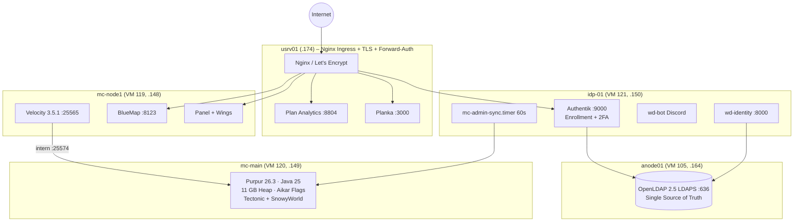
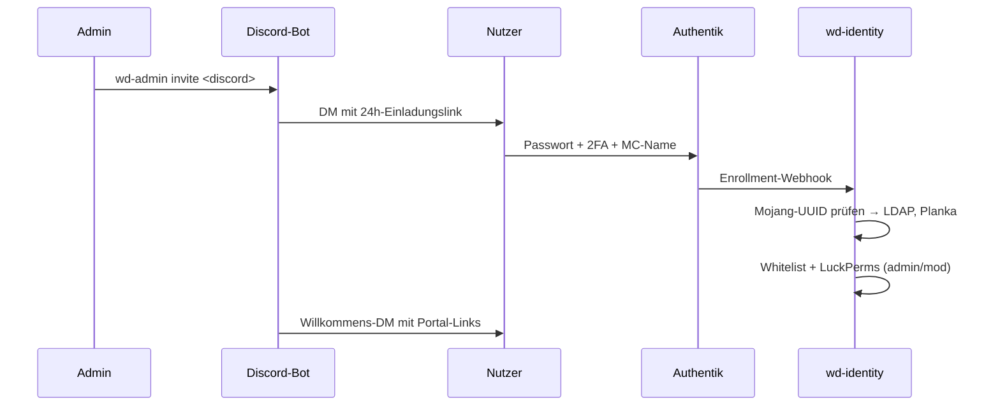

<div align="center">

# 🎄 Minecraft SMP Weihnachtsdorf 7

**Infrastructure-as-Code, Server-Tuning, Identity Management & Migrations-Playbooks**
für das 80-Spieler Weihnachts-Event am Spawn.


</div>

---

## 🌐 Portale & Endpunkte

| Dienst | Adresse | Schutz |
|---|---|---|
| 🎮 Minecraft Server | `tigimax.mooo.com:25565` (TCP) | Whitelist |
| 🎙️ Simple VoiceChat | `tigimax.mooo.com:24454` (UDP) | – |
| 🔐 Authentik SSO | https://auth.tigimax.mooo.com | 2FA (TOTP) |
| 🗺️ BlueMap Live-Karte | https://map.tigimax.mooo.com | Forward-Auth |
| 📊 Plan Analytics | https://plan.tigimax.mooo.com | Forward-Auth |
| 🦖 Pterodactyl Panel | https://panel.tigimax.mooo.com | Forward-Auth |
| 📋 Planka Kanban | https://tigimax.mooo.com | Forward-Auth |

> Ein gemeinsames Session-Cookie auf `.tigimax.mooo.com` sorgt für **Single Sign-On** über alle Portale.

---

## 🏗️ Architektur



---

## 👥 Identity Management (`wd-admin`)

Alle Admin-/Mod-Zugänge laufen über [`wd-admin`](tools/wd-identity/README.md) und den Discord-Bot **WHD Privileges**.

| Befehl | Wirkung |
|---|---|
| `wd-admin invite <discord> [--role admin\|mod]` | Einladung per Discord-DM (MC-Name nicht nötig) |
| `wd-admin reset <discord>` | Recovery-Link per DM |
| `wd-admin list` | Aktive Teammitglieder & Rechte |
| `wd-admin revoke <discord>` | Entzug in LDAP, Planka, Whitelist, LuckPerms |
| `wd-admin sync` | Whitelist & LuckPerms manuell synchronisieren |

### 🔄 Onboarding-Kette



---

## 📁 Repository-Struktur

```
.
├── ansible/            # Inventory & Playbooks für alle Nodes
├── configs/            # bluemap · mariadb · nginx · paper · purpur · spigot · velocity
├── datapacks/          # tectonic.zip · snowyworld.zip (Weltgenerierung)
├── docs/               # Architektur-, Deployment- & Migrations-Dokumente
├── scripts/            # provision_vms.sh · sync-mc-world.sh · BlueMap-Sync (service/timer)
└── tools/wd-identity/  # FastAPI-Backend, Discord-Bot, CLI, systemd-Units, Tests
```

---

## 📚 Dokumentation

| Dokument | Inhalt |
|---|---|
| [Identity, SSO, LDAP & Discord](docs/identity_sso_ldap_discord_guide.md) | Vollständige Auth-Architektur |
| [wd-identity Handbuch](tools/wd-identity/README.md) | Paket & CLI |
| [Pterodactyl & Velocity Deployment](docs/phase2_pterodactyl_deployment_report.md) | Phase-2-Report |
| [Tuning & Migrationsplan](docs/minecraft_pterodactyl_migration_plan.md) | Performance & Umzug |
| [Kritische Architektur-Prüfung](docs/minecraft_plan_critical_review.md) | Review & Risiken |
| [Crafty Controller (Legacy)](docs/minecraft_crafty_guide.md) | Alte Setup-Doku |

<div align="center">

---

Frohe Weihnachten & viel Spaß im Dorf! 🎅⛄

</div>
