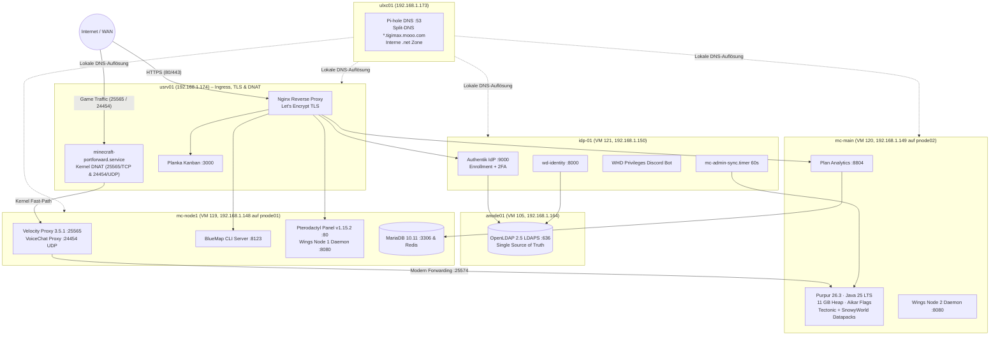
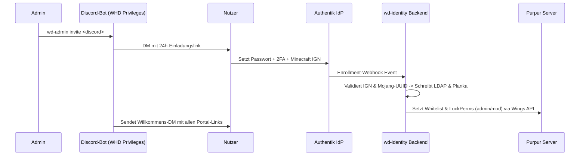

<div align="center">

# 🎄 Minecraft SMP Weihnachtsdorf 7

**Infrastructure-as-Code, Server-Tuning, Identity Management & Operations-Handbücher**  
für das 80–120 Spieler Weihnachts-Event am Spawn.

[](https://purpurmc.org)
[](https://papermc.io/software/velocity)
[](https://adoptium.net)
[](https://pterodactyl.io)
[](https://goauthentik.io)
[](ansible/)
[](configs/pihole/custom.list)

</div>

---

## 🌐 Portale & Endpunkte

| Dienst | Externe Adresse | Internes Ziel | Schutz / Authentifizierung |
|---|---|---|---|
| 🎮 **Minecraft Server** | `tigimax.mooo.com:25565` (TCP) | `mc-node1:25565` | Whitelist (Mojang Auth via Velocity HMAC) |
| 🎙️ **Simple VoiceChat** | `tigimax.mooo.com:24454` (UDP) | `mc-node1:24454` | Proximity Chat UDP (Kernel DNAT) |
| 🔐 **Authentik SSO** | https://auth.tigimax.mooo.com | `idp-01:9000` | 2FA (TOTP / WebAuthn) |
| 🗺️ **BlueMap Live-Karte** | https://map.tigimax.mooo.com | `mc-node1:8123` | Forward-Auth (`wd-bluemap`) |
| 📊 **Plan Analytics** | https://plan.tigimax.mooo.com | `mc-main:8804` | Forward-Auth (`wd-plan`) |
| 🦖 **Pterodactyl Panel** | https://panel.tigimax.mooo.com | `mc-node1:80` | Forward-Auth (`wd-panel`) |
| 📋 **Planka Kanban** | https://tigimax.mooo.com | `usrv01:3000` | Forward-Auth (`wd-planka`) |

> 🔑 Ein gemeinsames Session-Cookie auf `.tigimax.mooo.com` sorgt für nahtloses **Single Sign-On** über alle Web-Portale.

---

## 🏗️ Gesamte System- & Netzwerk-Architektur



---

## 👥 Identity & Berechtigungs-Management (`wd-admin`)

Alle Moderatoren- und Administratoren-Berechtigungen werden zentral über [`wd-admin`](tools/wd-identity/README.md) und den Discord-Bot **WHD Privileges** gesteuert.

| Befehl | Wirkung |
|---|---|
| `wd-admin invite <discord> [--role admin\|mod]` | Einladung per Discord-DM (MC-Name muss vorher nicht bekannt sein) |
| `wd-admin reset <discord>` | Einmaliger Passwort-Recovery-Link per Discord-DM |
| `wd-admin list` | Tabellarische Übersicht aller aktiven Teammitglieder, IGNs & UUIDs |
| `wd-admin revoke <discord>` | Sofortiger Entzug in LDAP, Planka, Whitelist und LuckPerms |
| `wd-admin sync [--force]` | Whitelist & LuckPerms manuell abgleichen (idempotent ohne Spam) |

### 🔄 Automatisierter Onboarding-Workflow



---

## 🤖 Infrastructure-as-Code (Ansible Automation)

Das Repository enthält automatisierte Ansible-Playbooks zur vollständigen Orchestrierung:

| Playbook | Pfad | Funktion |
|---|---|---|
| 🌐 **Pi-hole DNS** | [`ansible/playbooks/configure_pihole_dns.yml`](ansible/playbooks/configure_pihole_dns.yml) | Verteilt [`configs/pihole/custom.list`](configs/pihole/custom.list), sichert Alt-Configs und validiert DNS |
| 🛡️ **Firewall & Docker** | [`ansible/playbooks/configure_firewall.yml`](ansible/playbooks/configure_firewall.yml) | Richtet UFW & DOCKER-USER Chains ein (Isolierung von Purpur :25574 und BlueMap :8123) |
| 🚀 **Kernel-Tuning** | [`ansible/playbooks/tune_mc_nodes.yml`](ansible/playbooks/tune_mc_nodes.yml) | Deaktiviert Swap, optimiert Socket-Buffer (`rmem_max`/`wmem_max`) und `max_map_count` |
| 🦖 **Panel & DB Setup** | [`ansible/playbooks/setup_pterodactyl_panel.yml`](ansible/playbooks/setup_pterodactyl_panel.yml) | Installiert PHP 8.3, MariaDB, Redis und Pterodactyl Panel auf Node 1 |
| 🪽 **Wings Daemon** | [`ansible/playbooks/setup_wings_node.yml`](ansible/playbooks/setup_wings_node.yml) | Deployed Pterodactyl Wings Daemon und Systemd-Service auf den Nodes |
| 🗺️ **BlueMap Sync** | [`ansible/playbooks/setup_bluemap_sync.yml`](ansible/playbooks/setup_bluemap_sync.yml) | Deployed automatischen BlueMap World-Sync Service & Timer auf Node 1 |

Ausführen aller Playbooks über das zentrale Inventory:
```bash
ansible-playbook -i ansible/inventory.ini ansible/playbooks/<PLAYBOOK>.yml
```

---

## 📁 Repository-Struktur

```
.
├── ansible/                # Inventory & Playbooks für alle Nodes
│   ├── ansible.cfg         # Optimierte Ansible-Konfiguration
│   ├── inventory.ini       # Node-Zuordnungen & SSH-Parameter
│   └── playbooks/          # DNS-, Firewall-, Wings-, Panel- & Tuning-Playbooks
├── configs/                # Konfigurationen aller Dienste
│   ├── bluemap/            # BlueMap Core, Webserver & Webapp Konfiguration
│   ├── mariadb/            # SQL-Schemas (LuckPerms, CoreProtect, Plan)
│   ├── nginx/              # VHosts (auth, panel, map, plan, planka) & Snippets
│   ├── pihole/             # custom.list (Single Source of Truth für DNS)
│   ├── purpur/             # purpur.yml, paper-global.yml, server.properties
│   └── velocity/           # velocity.toml & voicechat-proxy.properties
├── datapacks/              # tectonic.zip · snowyworld.zip (100% Schneelandschaft)
├── docs/                   # Architektur-, Netzwerk-, Betriebshandbücher & Reports
├── scripts/                # Provisionierung, BlueMap-World-Sync (Timer/Service)
└── tools/wd-identity/      # FastAPI-Backend, Discord-Bot, CLI (wd-admin), Tests
```

---

## 📚 Vollständige Dokumentations-Übersicht

| Dokument | Schwerpunkte & Inhalt |
|---|---|
| 📖 **[Admin & Operations Handbook](docs/admin_operations_handbook.md)** | **Tägliche Wartung, Service-Lifecycle, `wd-admin` Referenz, Spark Profiling, Backups & Incident-Runbook** |
| 🌐 **[Network, DNS & Firewall Guide](docs/network_dns_firewall_guide.md)** | **Topologie, Ingress TLS, Kernel DNAT (`minecraft-portforward`), Pi-hole Split-DNS & UFW/Docker Chains** |
| 🔐 **[Identity, SSO, LDAP & Discord Guide](docs/identity_sso_ldap_discord_guide.md)** | **Vollständige Auth-Architektur, OpenLDAP `wdAccount` Schema, Discord Bot & Planka Provisioning** |
| 🛠️ **[wd-identity Handbuch](tools/wd-identity/README.md)** | **Python-Paket, FastAPI Webhooks, CLI-Installation & Unittest-Suite** |
| 🦖 **[Phase 2 Pterodactyl Deployment Report](docs/phase2_pterodactyl_deployment_report.md)** | **Deployment-Status, 20.00 TPS Verifikation & Schnee-Weltgenerierung** |
| 📐 **[Tuning & Migrationsplan](docs/minecraft_pterodactyl_migration_plan.md)** | **Ursprünglicher Migrationsplan, Aikar Flags & 80-Spieler Optimierungen (Abgeschlossen)** |
| 🎯 **[Kritische Architektur-Prüfung](docs/minecraft_plan_critical_review.md)** | **Architektur-Review, Risikoanalysen & Evaluierung der Tuning-Parameter** |
| 📦 **[Crafty Controller (Legacy)](docs/minecraft_crafty_guide.md)** | **Historische Dokumentation für Weihnachtsdorf 5 (Archiviert / Deprecated)** |

<div align="center">

---

Frohe Weihnachten & viel Spaß im Dorf! 🎅⛄

</div>
