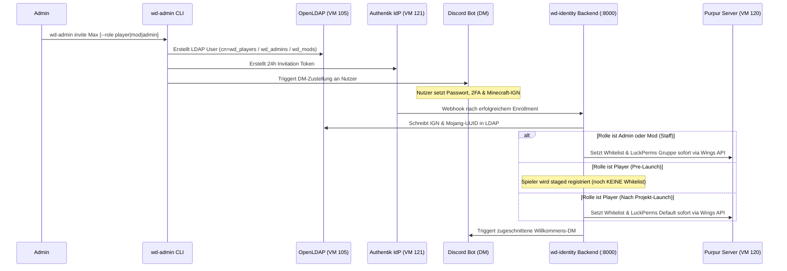
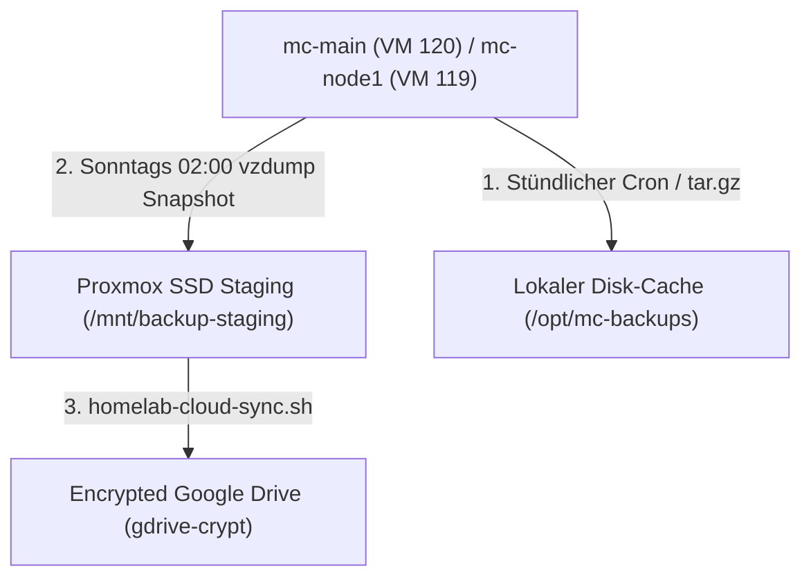

# Weihnachtsdorf 7 • Admin & Operations Handbook

**Version**: 1.0.0  
**Gültig für**: Minecraft SMP Weihnachtsdorf 7  
**Zielgruppe**: Serverbetreiber, Systemadministratoren & Moderatoren  

---

## 1. Quick Reference & System-Cheatsheet

### 🌐 Portale & Management-Endpunkte

| Dienst | Externe URL | Interner Port & Host | Authentifizierung |
|---|---|---|---|
| **Minecraft Server** | `tigimax.mooo.com:25565` | `mc-node1:25565` (DNAT via `usrv01`) | Whitelist (Mojang Auth) |
| **Simple Voice Chat** | `tigimax.mooo.com:24454` (UDP) | `mc-node1:24454` (DNAT via `usrv01`) | Proximity Chat UDP |
| **Authentik SSO** | https://auth.tigimax.mooo.com | `idp-01:9000` | 2FA (TOTP / WebAuthn) |
| **Pterodactyl Panel** | https://panel.tigimax.mooo.com | `mc-node1:80` | Forward-Auth (`wd-panel`) |
| **BlueMap Live-Karte** | https://map.tigimax.mooo.com | `mc-node1:8123` | Forward-Auth (`wd-bluemap`) |
| **Plan Analytics** | https://plan.tigimax.mooo.com | `mc-main:8804` | Forward-Auth (`wd-plan`) |
| **Planka Kanban** | https://tigimax.mooo.com | `usrv01:3000` | Forward-Auth (`wd-planka`) |
| **Pi-hole Admin** | http://192.168.1.173/admin | `ulxc01:80` | Web-Passwort |

> [!WARNING]
> **FreeDNS 6-Monats-Verfallsregel (`mooo.com`)**:
> Alle öffentlichen Subdomains (`*.tigimax.mooo.com`) sind über [FreeDNS (afraid.org)](https://freedns.afraid.org/) registriert. FreeDNS markiert Domains nach **6 Monaten Inaktivität** als abgelaufen und deaktiviert die Auflösung ohne Fehlermeldung. Sollten externe Zugriffe plötzlich fehlschlagen, muss sich der Betreiber bei afraid.org anmelden und die Records per Klick reaktivieren.

---

## 2. Service-Lifecycle & Server-Management

### 🦖 Pterodactyl Panel & Wings Daemon

Pterodactyl verwaltet die Minecraft-Container über zwei Nodes:
- **Node 1 (`mc-node1`, `192.168.1.148`)**: Hostet das Panel, MariaDB, Redis und den Velocity-Proxy Container (`8651ca23`).
- **Node 2 (`mc-main`, `192.168.1.149`)**: Hostet den Purpur Hauptwelt-Container (`a173d02e`).

#### Wings Daemon Befehle (auf `mc-node1` oder `mc-main`)
```bash
# Status prüfen
sudo systemctl status wings

# Live-Logs beobachten
sudo journalctl -u wings -f

# Wings Daemon neustarten (stoppt laufende Server NICHT)
sudo systemctl restart wings
```

#### Panel Hintergrund-Worker (auf `mc-node1`)
```bash
# Queue-Worker Status prüfen
sudo systemctl status pteroq.service

# MariaDB & Redis Status
sudo systemctl status mariadb redis-server php8.3-fpm
```

---

### 🎮 Minecraft Server: Velocity Proxy & Purpur Backend

#### Starten, Stoppen & Neustarten
- **Regulär**: Über das Web-Interface https://panel.tigimax.mooo.com.
- **Per CLI (im Notfall auf Node 2)**:
  ```bash
  # Docker-Container direkt ansprechen (Weihnachtsdorf 7)
  docker ps | grep -E 'purpur|velocity'
  docker restart <CONTAINER_ID>

  # Server-Befehle direkt via lokales RCON-Tool senden:
  sudo mc-cmd "spark health"
  sudo mc-cmd "chunky progress"
  sudo mc-cmd "whitelist list"
  ```

#### Live-Konsole & Chat-Befehle
- Über Pterodactyl Console auf https://panel.tigimax.mooo.com
- **Wichtige Ingame-Befehle (für Admins)**:
  ```text
  /spark health            -> TPS, MSPT, CPU und Memory sofort anzeigen
  /spark profiler --start  -> Profiler starten
  /spark profiler --stop   -> Profiler stoppen und Web-Link ausgeben
  /whitelist list          -> Whitelist-Mitglieder anzeigen
  /whitelist reload        -> Whitelist neu einlesen
  /lp user <IGN> info      -> LuckPerms Gruppen und Rechte prüfen
  /save-all                -> Welt sofort auf Festplatte sichern
  ```

---

### 🏔️ Weltgenerierung: Standard Upstream Datapacks (Terralith & Terratonic)

Die Welt nutzt ausschließlich die **offiziellen, unveränderten Upstream-Releases** der Datapacks (keine manuellen JSON-Änderungen oder Biome-Hacks):

- **Datapacks (100% Unmodified Upstream)**:
  - `terralith.zip`: Offizielles Release `v2.6.5+26.3` von Stardust Labs (preisgekrönte, prozedural abgestimmte Weltgenerierung mit über 100 Biomen, nahtlosem Blending, Riesenbäumen und Gebirgen).
  - `terratonic.zip`: Offizielle Kompatibilitäts-Bridge `v3.0.31` von Apollo zur Fusionierung der tektonischen Terrain-Höhen mit Terralith.
- **Topografie & Einstellungen**:
  - **Seed**: Standard Minecraft Random Seed (keine künstliche Erzwingung).
  - **Spawn**: Natürlicher Minecraft World-Spawn.
  - **BlueMap Startposition**: Standard `(0, 0)`.
- **Vorab-Generierung (Chunky)**:
  ```bash
  # Chunky-Status prüfen:
  sudo mc-cmd "chunky progress"

  # Chunky pausieren/fortsetzen:
  sudo mc-cmd "chunky pause"
  sudo mc-cmd "chunky continue"
  ```

---

### 🗺️ BlueMap Synchronisation (`mc-node1`)

Da BlueMap auf `mc-node1` (VM 119) als eigenständiger Dienst läuft, um CPU auf dem Hauptserver zu schonen, wird die Welt alle 5 Minuten von `mc-main` synchronisiert.

```bash
# Manueller World-Sync von mc-main auf mc-node1:
/usr/local/bin/sync-mc-world.sh

# Status des automatischen Sync-Timers prüfen:
systemctl status bluemap-world-sync.timer
journalctl -u bluemap-world-sync.service -n 50 --no-pager
```

---

### 🔐 Identity Stack (`idp-01`)

Auf `idp-01` (`192.168.1.150`) laufen die Authentik- und Sync-Dienste:

```bash
# Status aller Identity-Dienste abfragen
sudo systemctl status wd-identity.service wd-bot.service mc-admin-sync.timer

# Logs von wd-identity beobachten (Webhooks & Provisionierung)
sudo journalctl -u wd-identity.service -f

# Logs des Discord-Bots beobachten
sudo journalctl -u wd-bot.service -f

# Manueller Durchlauf des Minecraft-Admin-Syncs
sudo mc-admin-sync
```

---

### 🌐 Ingress & DNAT (`usrv01`)

Auf `usrv01` (`192.168.1.174`):

```bash
# Nginx-Konfiguration validieren & neu laden
sudo nginx -t && sudo systemctl reload nginx

# Kernel DNAT Forwarding prüfen & neustarten
sudo systemctl status minecraft-portforward.service
sudo systemctl restart minecraft-portforward.service

# Aktive iptables NAT-Regeln auflisten
sudo iptables -t nat -L -n -v
```

---

## 3. Team-, Spieler- & Berechtigungsverwaltung (`wd-admin`)

Alle Moderatoren, Administratoren und regulären Event-Spieler werden zentral über das Werkzeug [`wd-admin`](../tools/wd-identity/README.md) verwaltet.

### 📋 Befehlsübersicht & Onboarding-Flow



#### 1. Spieler oder Teammitglied einladen
```bash
# Regulären Spieler vorab einladen (Default-Rolle: player)
wd-admin invite <discord_name> [--role player|mod|admin] [--ign <minecraft_ign>] [--username <uid>]
```
- Legt das Konto in LDAP an (`ou=User,dc=ldap-01,dc=net`).
- Ordnet die LDAP-Gruppe zu (`cn=wd_players`, `cn=wd_admins` oder `cn=wd_mods`).
- Generiert einen 24h gültigen Authentik-Einladungslink.
- Der Discord-Bot `WHD Privileges` stellt den Link per DM zu.
- Der Nutzer trägt seinen Minecraft-Namen selbst ein; Mojang-UUID wird automatisch validiert.
- **Pre-Launch Gate**: Reguläre Spieler erhalten vor dem offiziellen Projektstart noch **keinen** Whitelist-Zugang und werden vorab registriert. Beim Versuch zu joinen erhalten sie eine freundliche Kick-Meldung.
- **Dienste-Schutz**: Durch die Authentik-Richtlinie `wd-staff-only-policy` sind Pterodactyl Panel, Planka Kanban und Plan Analytics für reguläre Spieler gesperrt (HTTP 403).

#### 2. Projekt-Status & Whitelist-Launch Gate
```bash
# Launch-Status & Zähler abfragen
wd-admin project status

# Projekt offiziell starten (schaltet alle registrierten Spieler sofort frei)
wd-admin project launch

# Server wieder in den Wartungs-/Pre-Launch-Modus versetzen (Spieler gesperrt, Staff aktiv)
wd-admin project lock
```

#### 3. Passwort zurücksetzen
```bash
wd-admin reset <discord_name>
```
- Sendet dem Nutzer einen zeitlich begrenzten Recovery-Link per Discord-DM.

#### 4. Übersicht aller Accounts anzeigen
```bash
wd-admin list
```
- Zeigt Staff-Mitglieder und reguläre Spieler getrennt mit Discord-Tag, verknüpftem Minecraft Ingame-Namen, UUID und Whitelist-Status (`[PRE-REGISTERED]` vs. `[WHITELISTED]`) an.

#### 5. Benachrichtigungen per Bot senden (Notify / Broadcast)
```bash
# Nachricht an alle Admins senden:
wd-admin notify --role admin "Hallo Team, hier ist das neue Git-Repository: https://github.com/Tigimax/minecraft-weihnachtsdorf-team"

# Kurzform für Rollen (admin, mod, staff, player, all):
wd-admin notify admin "Hallo Admins!"
wd-admin notify staff "Wichtige Team-Info..."
wd-admin notify players "Server startet in 15 Minuten!"

# Nachricht an einen einzelnen Benutzer:
wd-admin notify nummernfeld "Hier ist dein Link: https://..."

# In Scripts ohne Bestätigungsabfrage (-y):
wd-admin notify --role admin -y "Automatisches Update eingespielt"
```
- Nutzt den Discord-Bot `WHD Privileges`, um DMs an Benutzer oder Rollen-Gruppen zu senden.

#### 6. Berechtigungen entziehen (Revoke)
```bash
wd-admin revoke <discord_name>
```
- Entfernt den Benutzer aus LDAP-Gruppen (`wd_admins`/`wd_mods`/`wd_players`).
- Deaktiviert das Konto in Planka (falls vorhanden).
- Entfernt den Spieler von der Minecraft-Whitelist und setzt LuckPerms auf `default`.

#### 6. Manuelle Synchronisation erzwingen
```bash
wd-admin sync [--force]
```
- Gleicht alle LDAP-Mitglieder mit der Minecraft-Whitelist und LuckPerms ab. Regular Players werden nur freigeschaltet, wenn das Projekt live geschaltet ist.
- Gleicht LDAP sofort mit Whitelist und LuckPerms ab.

---

### 🧩 Pterodactyl Blueprint Framework & Extensions

Auf `mc-node1` ist das [Blueprint Framework](https://blueprint.zip/) (`beta-2026-08`) für Pterodactyl installiert.

* **Admin-Interface:** Im Pterodactyl Admin-Bereich (Zahnrad oben rechts) unter **Extensions** (`/admin/extensions`).
* **Aktive Erweiterungen:**
  1. **Darkenate (`darkenate`)**: Modernes Dark-Theme für das gesamte Panel.
  2. **Modrinth Browser (`modrinthbrowser`)**: Ermöglicht die Suche und 1-Klick-Installation von Minecraft-Plugins direkt im Server-Menü.
  3. **PteroMonaco (`pteromonaco`)**: Ersetzt den Standard-Dateieditor durch den VS Code Monaco-Editor mit Syntax-Highlighting.
  4. **Minecraft Player Manager (`minecraftplayermanager`)**: Dedizierter Server-Tab **Players** mit 3D-Skins, Köpfen, Whitelist/OP/Ban/Kick-Listen, Whisper und Inventar-Management.
* **Datenbank-Hosts (Databases Tab):**
  * Für `mc-node1` und `mc-node2` (`mc-main`) ist MariaDB als Database Host registriert (`ptero_mgr`). Admins können im Server-Tab **Databases** per Mausklick eigene Datenbanken erzeugen.
* **CLI-Befehle (auf `mc-node1`):**
  ```bash
  # Extension installieren (.blueprint Datei hochladen nach /var/www/pterodactyl/):
  blueprint -i <extension_name>

  # Installierte Extensions anzeigen:
  blueprint -q

  # Frontend nach Änderungen neu bauen:
  blueprint -b

  # Extension entfernen:
  blueprint -r <extension_name>
  ```
* **Hinweis bei Pterodactyl-Updates:**
  Falls Pterodactyl aktualisiert wird, muss `blueprint -b` ausgeführt werden und sichergestellt werden, dass [`AuthentikSsoMiddleware`](file:///home/dweisstan/agy/minecraft-weihnachtsdorf/configs/pterodactyl/AuthentikSsoMiddleware.php) in `app/Http/Kernel.php` registriert bleibt. Backups liegen in `/var/backups/pterodactyl/`.

---

### 🚨 Notfall-Zugang (Bypass-Prozeduren)

Falls Authentik oder der Discord-Bot temporär ausfallen:
1. **Manueller Whitelist-Eintrag auf Purpur**:
   Im Panel (https://panel.tigimax.mooo.com) oder per Wings Console:
   ```text
   whitelist add <IGN>
   lp user <IGN> parent set admin
   ```
2. **Direkter SSH-Zugang**:
   SSH auf die Nodes mit dem autorisierten Schlüssel `tigimax`:
   ```bash
   ssh tigimax@192.168.1.148  # mc-node1
   ssh tigimax@192.168.1.149  # mc-main
   ```

---

## 4. Performance-Monitoring & Profiling

### ⚡ Spark Profiler Leitfaden

Spark ist auf Purpur integriert und bietet Live-Metriken:

#### 1. Echtzeit-Gesundheit prüfen
```text
/spark health --memory
```
- Zeigt TPS (Soll: `20.00`), MSPT (Millisekunden pro Tick, Soll: `<20 ms`) und CPU-Auslastung.
- Zeigt Heap-Nutzung (aktiv / reserviert von 11.0 GB) und GC-Pausen.

#### 2. CPU-Profiler durchführen (bei Lags)
```text
/spark profiler --timeout 60
```
- Profilt 60 Sekunden lang alle Server-Threads.
- Gibt eine URL zu `spark.lucko.me` aus mit interaktivem Flamegraph.
- Zeigt exakt, welche Plugins, Entities oder Redstone-Schaltungen Ticks blockieren.

#### 3. Garbage Collection analysieren
```text
/spark gc
```
- Zeigt G1GC-Zyklen und Pause-Zeiten.

---

### 📊 Plan Analytics Dashboard

Erreichbar unter https://plan.tigimax.mooo.com:
- **Player Trends**: Gleichzeitige Spielerzahlen am Spawn.
- **Performance Tab**: Historische TPS/MSPT-Kurven über Stunden und Tage.
- **World & Chunks**: Geladene Chunks und Entity-Verteilungen.

---

## 5. Backup, Synchronisation & Disaster Recovery

### 💾 Backup-Hierarchie



1. **Stündliche Welt-Snapshots**:
   Auf `mc-main` rotiert ein stündlicher Snapshot der Welt-Ordner in `/opt/mc-backups/` (letzte 6 Stunden).
2. **Proxmox vzdump VM-Snapshots**:
   Jeden Sonntag um 02:00 Uhr sichert Proxmox vollständige Snapshots von VM 119 und VM 120 auf SSD-Staging, anschließend synchronisiert zu verschlüsseltem Google Drive.
3. **MariaDB Dumps (`mc-node1`)**:
   ```bash
   # Alle Minecraft-Datenbanken sichern:
   mysqldump -u root -p --databases mc_luckperms mc_coreprotect mc_plan panel > /opt/backups/mariadb_$(date +%F).sql
   ```

---

### 🔄 Disaster Recovery: Node-Wiederherstellung mit Ansible

Sollte ein Server oder eine VM komplett ausfallen:

```bash
# 1. Basis-VM auf Proxmox erzeugen (falls gelöscht)
./scripts/provision_vms.sh

# 2. Kernel-Tuning & Swap-Deaktivierung anwenden
ansible-playbook -i ansible/inventory.ini ansible/playbooks/tune_mc_nodes.yml

# 3. Docker CE & Wings Daemon installieren
ansible-playbook -i ansible/inventory.ini ansible/playbooks/setup_wings_node.yml

# 4. Pterodactyl Panel & MariaDB auf Node 1 provisionieren
ansible-playbook -i ansible/inventory.ini ansible/playbooks/setup_pterodactyl_panel.yml

# 5. UFW & Docker-User Chains aufsetzen
ansible-playbook -i ansible/inventory.ini ansible/playbooks/configure_firewall.yml

# 6. BlueMap Welt-Sync Service & Timer auf Node 1 einrichten
ansible-playbook -i ansible/inventory.ini ansible/playbooks/setup_bluemap_sync.yml

# 7. Pi-hole DNS synchronisieren & validieren
ansible-playbook -i ansible/inventory.ini ansible/playbooks/configure_pihole_dns.yml
```

> 🔑 **SSH-Key für BlueMap World-Sync**:  
> Der World-Sync (`/usr/local/bin/sync-mc-world.sh`) nutzt `ssh -i /home/tigimax/.ssh/id_ed25519`. Nach einer Neuinstallation muss sichergestellt sein, dass der SSH-Public-Key von `tigimax@mc-node1` in `~/.ssh/authorized_keys` auf `mc-main` (`192.168.1.149`) hinterlegt ist und `sudo rsync` passwortlos ausgeführt werden darf.

---

## 6. Troubleshooting Matrix & Incident Runbook

| Problem | Mögliche Ursache | Diagnose & Lösung |
|---|---|---|
| **Alle externen *.tigimax.mooo.com URLs antworten nicht (NXDOMAIN/Timeout)** | FreeDNS 6-Monats-Inaktivität abgelaufen | 1. Einloggen auf https://freedns.afraid.org<br/>2. Status der Subdomains prüfen und reaktivieren<br/>3. Lokalen Resolver prüfen: `dig @1.1.1.1 panel.tigimax.mooo.com` |
| **Spieler können nicht verbinden** | Ingress DNAT oder Velocity down | 1. `systemctl status minecraft-portforward.service` auf `usrv01`<br/>2. `systemctl status wings` auf `mc-node1`<br/>3. Ping auf `tigimax.mooo.com:25565` via `nc -zv 192.168.1.148 25565` |
| **Simple Voice Chat bleibt rot (kein Audio)** | Port 24454/UDP geblockt | 1. Prüfen, ob `voicechat-proxy.properties` auf Port 24454 läuft<br/>2. Prüfen, ob Ingress UDP weiterleitet: `iptables -t nat -L PREROUTING -n -v \| grep 24454` auf `usrv01` |
| **502 Bad Gateway auf panel / map / plan** | Backend-Dienst oder Node offline | 1. Prüfen, ob Ziel-Port lauscht (`netstat -tlpn`)<br/>2. BlueMap HTTP: `curl -I http://192.168.1.148:8123`<br/>3. Plan HTTP: `curl -I http://192.168.1.149:8804` |
| **Authentik Redirect-Loop** | Cookie-Domain oder Zeit-Drift | 1. Browser-Cookies für `.tigimax.mooo.com` löschen<br/>2. NTP-Sync auf allen Hosts prüfen: `timedatectl status` |
| **Discord-Bot stellt keine DMs zu** | Privatsphäre-Einstellungen des Users | 1. Prüfen, ob User auf dem Server ist<br/>2. User bitten: *Privatsphäre -> Direknachrichten von Servermitgliedern erlauben*<br/>3. Alternativ Discord Snowflake-ID übergeben: `wd-admin invite <ID>` |
| **Whitelist oder LuckPerms nicht synchron** | Timer oder Wings API hängt | 1. Sync manuell erzwingen: `wd-admin sync --force`<br/>2. Logs prüfen: `journalctl -u wd-identity -n 30` |
| **Niedrige TPS (<18 TPS)** | Entity-Anhäufung oder Chunk-Lag | 1. `/spark health` ausführen<br/>2. `/spark profiler --timeout 60` starten<br/>3. Ggf. `/kill @e[type=item]` oder Chunky-Status prüfen |
| **Interne Hostnamen lösen nicht auf** | Pi-hole Container gestoppt | 1. `docker ps` auf `ulxc01` prüfen<br/>2. Playbook ausführen: `ansible-playbook -i ansible/inventory.ini ansible/playbooks/configure_pihole_dns.yml` |

---

## 7. Verwandte Dokumentationen

- 🌐 [Network, DNS & Firewall Guide](network_dns_firewall_guide.md) – Ingress, TLS, Kernel DNAT, Pi-hole Split-DNS & UFW Chains.
- 🔐 [Identity, SSO, LDAP & Discord Guide](identity_sso_ldap_discord_guide.md) – Detaillierte SSO-Architektur & OpenLDAP Schemas.
- 🦖 [Phase 2 Pterodactyl Deployment Report](phase2_pterodactyl_deployment_report.md) – Deployment-Report, Weltgenerierung & Tuning.
