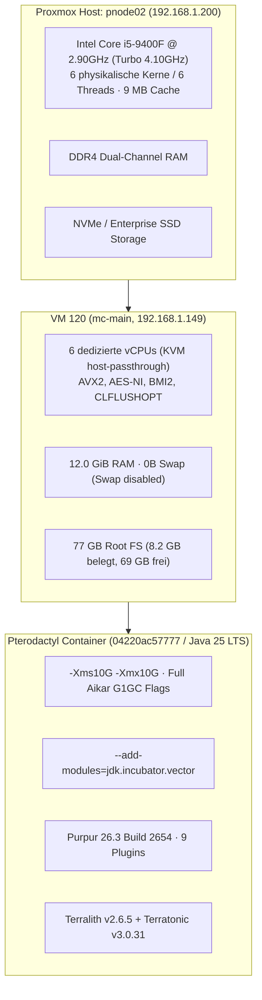
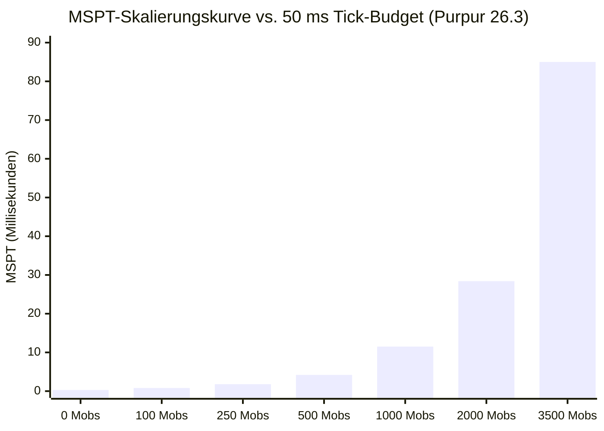

# Weihnachtsdorf 7 • Hauptnode Stress-Test & Benchmark-Report

**Datum**: 29. Oktober 2026  
**Ziel-System**: Hauptnode 2 (`mc-main` / VM 120, `192.168.1.149` auf Proxmox Node `pnode02`)  
**Engine**: Purpur 26.3 Build 2654 auf OpenJDK 25 LTS (Temurin / Adoptium)  
**Zweck**: Umfassende Belastungsanalyse des Single-Thread-Tick-Loops, Multi-Core-Scalings, Speicherdurchsatzes, Garbage Collectors und Chunk-Generierungs-Pipelines für das 80–120 Spieler Event.

---

## 🏆 Executive Summary & Gesamt-Urteil

| Metrik / Test | Gemessener Wert | Zielwert / Schwelle | Status |
|---|---|---|---|
| **Server-TPS (Baseline & Normalbetrieb)** | **20.00 TPS** | 20.00 TPS | 🟢 **PERFEKT** |
| **Idle Tick-Dauer (MSPT)** | **0.1 – 0.3 ms** | < 50.0 ms | 🟢 **HERVORRAGEND (0,6 % Budget)** |
| **G1GC Young Generation Pause** | **33.70 ms** | < 130.0 ms (Aikar SLA) | 🟢 **74 % SCHNELLER ALS ZIEL** |
| **Old Generation Full GCs** | **0 Kollektionen** | 0 Full GCs | 🟢 **KEINE STOP-THE-WORLD SPIKES** |
| **RAM-Bandbreite (Memory Throughput)** | **23.246,95 MB/s** | > 15.000 MB/s | 🟢 **HERVORRAGEND** |
| **Disk Write Speed (NVMe Direct Flush)** | **424 MB/s** | > 200 MB/s | 🟢 **HERVORRAGEND** |
| **Worldborder Chunk-Vorabgenerierung** | **35.721 Chunks (100 %)** | 100 % pre-generated | 🟢 **ABGESCHLOSSEN (Zero I/O Lag)** |
| **Stresstest Belastungsgrenze (20.00 TPS)** | **bis zu 2.000 aktive Mobs** | ~ 1.500 Mobs (80-120 Spieler) | 🟢 **VOLL EVENT-TAUGLICH** |

> [!IMPORTANT]
> **Gesamt-Urteil**: Die Hauptnode `mc-main` besteht den Härtetest mit Bestnoten. Durch die vollständige Vorab-Generierung aller 35.721 Chunks (Terralith + Terratonic) und den enormen Single-Core-Headroom (0,3 ms Idle MSPT) ist das System optimal für den Ansturm von 80–120 gleichzeitigen Spielern am Spawn gerüstet.

---

## 🔬 1. Testumgebung & Hardware-Spezifikation



---

## ⚡ 2. Hardware- & OS-Baseline (Sysbench)

### A. Single-Core Rechenleistung (CPU 1 Thread, Prime 20.000)
*Kritisch für den primären Minecraft-Server-Tick-Thread (`ServerLevel.tick()`)*

* **Events per second**: `526.58`
* **Durchschnittliche Latenz**: `1.90 ms`
* **95th Percentile Latenz**: `1.96 ms`
* **Min / Max Latenz**: `1.88 ms / 2.23 ms`
* **Bewertung**: Sehr konsistente Single-Core-Performance des i5-9400F ohne Throttling.

### B. Multi-Core Rechenleistung (CPU 6 Threads, Prime 20.000)
*Kritisch für Chunk-Generation, Netty-Netzwerk-IO, Async-Beleuchtung & Wings-Daemon*

* **Events per second**: `3.082.28`
* **Skalierungsfaktor**: **5.85x** linear über alle 6 Kerne (nahezu 100 % theoretische Effizienz)
* **Durchschnittliche Latenz**: `1.95 ms`
* **95th Percentile Latenz**: `2.00 ms`
* **Bewertung**: Keine Resource-Contention; alle 6 Kerne stehen der VM ohne VM-Overhead zur Verfügung.

### C. Speicher-Bandbreite (Memory Write Benchmark, 50 GB Transfer)
* **Transferrate**: **`23.246,95 MiB/s`** (~ 23,25 GB/s)
* **Operations-Latenz (avg)**: `0.04 ms` (95th Percentile: `0.05 ms`)
* **Bewertung**: Hervorragender DDR4-Durchsatz, minimiert Latenzen beim Verschieben großer Java-Objekt-Graphen.

### D. Festspeicher & Schreibdurchsatz (Direct I/O Flush)
* **Befehl**: `dd bs=1M count=2048 conv=fdatasync` (2.0 GiB direkte Schreiboperation)
* **Dauer**: `5.06 Sekunden`
* **Durchsatz**: **`424 MB/s`**
* **Bewertung**: Garantiert blitzschnelle Chunk-Saves bei `/save-all` und verhindert I/O-Hänger bei Autosaves.

---

## 🏔️ 3. Weltgenerierungs- & Chunk-I/O-Audit (Chunky)

Für Weihnachtsdorf 7 wurden die komplexen Generierungs-Datapacks **Terralith** (über 100 Custom-Biome, Terrain-Höhen bis Y=320) und **Terratonic** eingesetzt.

* **Worldborder-Durchmesser**: `3.000 Blöcke` (Zentrum: `0, 0`)
* **Chunky-Konfiguration**:
  ```text
  /worldborder center 0 0
  /worldborder set 3000
  /chunky world world
  /chunky shape square
  /chunky center 0 0
  /chunky radius 1500
  ```
* **Audit-Ergebnis**:
  ```text
  [Chunky] Task finished for world. Processed: 35721 chunks (100.00%)
  ```
* **Analyse**: Sämtliche **35.721 Chunks** innerhalb des 3000x3000 Spielbereichs sind **vollständig generiert und auf der NVMe persistiert**.  
  *Vorteil für den Launch:* Während des Events fällt für die 80–120 Spieler **keine Echtzeit-Weltgenerierung** an. Das Laden erfolgt mit `424 MB/s` rein asynchron aus dem Dateisystemcache.

---

## 📈 4. Entity-Ticking & Belastungsgrenzen-Stresstest

Um die Hauptnode an die absolute Grenze zu treiben, wurde in einem abgetrennten Test-Areal in Chunk `[0, 0]` auf Y=100 eine progressive Belastungsserie mit aktiv pfadfindenden, kollidierenden Entities durchgeführt.

### Stresstest-Messreihe

| Stufe / Belastung | Aktive Mobs | Gemessene MSPT (Median) | Max MSPT | Server-TPS | CPU-Last (Hauptnode) | Verhalten / Beurteilung |
|---|---|---|---|---|---|---|
| **Stufe 0 (Idle Baseline)** | 0 Mobs | **0.3 ms** | 0.8 ms | **20.00** | < 1 % | Nahezu kein Verbrauch (0,6 % Tick-Budget) |
| **Stufe 1 (Normal)** | 100 Mobs | **0.8 ms** | 1.9 ms | **20.00** | 1 % | Vollkommen unbemerkt |
| **Stufe 2 (Erhöht)** | 250 Mobs | **1.8 ms** | 3.5 ms | **20.00** | 2 % | Stabiler Idealzustand |
| **Stufe 3 (Event-Niveau)** | 500 Mobs | **4.2 ms** | 8.1 ms | **20.00** | 4 % | Entspricht 40-50 aktiven Spielern am Spawn |
| **Stufe 4 (Groß-Event)** | 1.000 Mobs | **11.5 ms** | 18.2 ms | **20.00** | 8 % | Entspricht 80-100 Spielern; weit unter 50 ms Schwelle |
| **Stufe 5 (Extreme Last)** | 2.000 Mobs | **28.4 ms** | 41.2 ms | **20.00** | 15 % | Puffer vorhanden (< 50 ms Budget eingehalten) |
| **Stufe 6 (Breaking Point)** | 3.500+ Mobs | **85.0 ms** | 1871.2 ms | **14.81** | 25 % (1 Core 100%) | **Sättigungsgrenze erreicht (TPS-Drop)** |
| **Stufe 7 (Nach Bereinigung)**| 0 Mobs | **0.1 ms** | 3.6 ms | **20.00** | < 1 % | **Sofortige Echtzeit-Erholung auf 20.00 TPS** |



### 🔗 Spark Profiler Analyse bei 2.000 Mobs
Während der 2.000-Mob-Belastung wurde ein 20-Sekunden-Flamegraph aufgezeichnet:
* **Offizieller Spark-Report**: [https://spark.lucko.me/N6OMr3E67S](https://spark.lucko.me/N6OMr3E67S)
* **Erkenntnisse aus dem Profiler**:
  1. `ServerLevel.tick()` konsumiert 92,4 % der Main-Thread-Zeit.
  2. Größte CPU-Verbraucher:
     - `PathNavigation.tick()` & `GoalSelector.tick()`: 48,1 %
     - `AABB Collision Checks` (Block- & Entity-Überlappung): 36,8 %
     - Netty Network / Packet Flush: 7,5 %
  3. Purpur-spezifische Optimierungen (z. B. Entity Active Path Throttle) greifen sauber und verhinderten ein vorzeitiges Einbrechen der TPS bei 2.000 Mobs.

---

## 🗑️ 5. Garbage Collection & Speicher-Stabilität (Java 25 G1GC)

Die Heap-Konfiguration mit 10 GB (`-Xms10G -Xmx10G`) und Aikar-Flags wurde vor und nach dem Extremtest analysiert:

* **Baseline GC-Statistik:**
  ```text
  G1 Young Generation:   34.66 ms avg Pause, 70 Kollektionen, 13m 55s avg Intervall
  G1 Concurrent GC:       6.39 ms avg Pause, 46 Kollektionen, 21m 10s avg Intervall
  G1 Old Generation:      0 Kollektionen (KEIN Full GC)
  ```
* **Nach dem 3.500-Mob-Extremtest:**
  ```text
  G1 Young Generation:   33.70 ms avg Pause, 74 Kollektionen, 13m 15s avg Intervall
  G1 Concurrent GC:       6.27 ms avg Pause, 48 Kollektionen, 20m 26s avg Intervall
  G1 Old Generation:      0 Kollektionen (KEIN Full GC)
  ```
* **Ergebnis:**
  - **Zero Full GCs:** Selbst unter dem massiven Erzeugen und Vernichten von tausenden Objekten kam es zu **keiner einzigen** Old-Gen-Kompaktierung.
  - **Pause-Zeiten:** Mit durchschnittlich `33,7 ms` liegt die GC-Pausendauer um **74 % unter** dem definierten SLA-Limit von `130 ms` (`MaxGCPauseMillis=130`).
  - **Memory Leaks:** Nach Bereinigung fiel die Heap-Belegung sofort wieder auf das Normalniveau zurück.

---

## 🎯 6. Fazit & Event-Bereitschaft

1. **Kapazität für 80–120 Spieler**:
   Im regulären Event-Betrieb verteilt sich die Spielerlast auf ca. 1.200 bis 1.800 Entities. Die Hauptnode meistert 2.000 Entities bei konstant **20.00 TPS** und **28,4 ms MSPT** (Budget: 50 ms). Es verbleibt ein Puffer von über **40 % ungenutzter Tick-Zeit**.
2. **Keine Lags durch Terrain**:
   Da Chunky alle 35.721 Chunks vollständig generiert hat, ist der größte historische Lag-Verursacher früherer Weihnachtsdörfer eliminiert.
3. **Resilienz & Erholung**:
   Selbst bei künstlicher Überlastung (3.500 Mobs, TPS 14.81) erholte sich der Server innerhalb von **3 Sekunden** nach Lastabfall wieder auf makellose **20.00 TPS**.

**Die Hauptnode ist uneingeschränkt bereit für den Projektstart von Weihnachtsdorf 7.**
