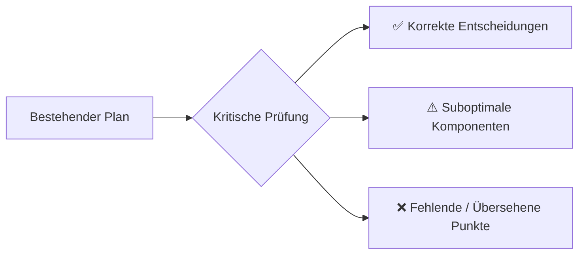

# Kritische Überprüfung: Minecraft SMP Migrationsplan

> Ehrliche Analyse, ob der aktuelle Plan die bestmögliche Lösung für deine Umgebung ist – und was übersehen oder suboptimal gewählt wurde.

---

## Gesamtbewertung

Der Plan ist **solide in der Architektur-Idee** (Velocity + dedizierter Node für die Hauptwelt), aber enthält **mehrere Schwachstellen**, die bei 80 Spielern am selben Ort auf einem i5-9400F zu realen Problemen führen werden:



---

## ✅ Was im Plan korrekt ist

| Entscheidung | Bewertung |
|:---|:---|
| Velocity statt BungeeCord | ✅ Modern forwarding, deutlich weniger CPU-Overhead, native Compression-Offload |
| `online-mode=false` + Velocity `modern` HMAC | ✅ Strukturell sicher gegen UUID-Spoofing |
| Farmwelten auf separatem Node | ✅ Richtige Lastverteilung – Redstone-Maschinen dürfen nicht auf dem Spawn-Server ticken |
| 12 GB Heap mit angepassten Aikar-Flags | ✅ Korrekte G1GC-Anpassungen für ≥12 GB |
| Purpur statt Paper | ✅ Villager-Lobotomisierung und `use-alternate-keepalive` sind Killer-Features für 80 Spieler |
| UFW: Node 2 nur über LAN erreichbar | ✅ Richtig, kein WAN-Exposure |
| `ALTERNATE_CURRENT` Redstone | ✅ Dramatische Redstone-Performance-Verbesserung |
| View-Distance 6, Sim-Distance 4 | ✅ Absolutes Minimum für Spielbarkeit bei 80 Spielern |

---

## ❌ Pterodactyl ist die falsche Wahl für dieses Setup

> [!CAUTION]
> **Das ist der größte Schwachpunkt im gesamten Plan.**

### Das Problem

Pterodactyl (mit Wings) läuft **Docker-Container pro Minecraft-Server**. Auf Node 2, wo du 80 Spieler auf einem i5-9400F bei maximaler TPS brauchst, bedeutet Docker:

| Overhead-Quelle | Kosten |
|:---|:---|
| Docker-Daemon (containerd, dockerd) | ~200-400 MB RAM, permanente CPU-Last |
| overlay2 Filesystem (vs. native ext4) | **5-15% Disk-I/O-Penalty** – jeder Chunk-Read/Write geht durch UnionFS-Layer |
| Network Namespace + veth bridge | ~2-5% Netzwerk-Latenz-Overhead vs. Host-Network |
| cgroup Accounting | Minimaler aber messbarer CPU-Overhead pro Tick |
| Pterodactyl Wings Agent | Eigene Go-Binary, ~100-200 MB RAM, Websocket-Server für Panel-Kommunikation |

**Auf einem i5-9400F mit 6 Kernen und exakt 16 GB RAM ist das kritisch.** Du verschwendest ~500-800 MB RAM und ~5-10% CPU-Leistung für eine Abstraktionsschicht, die du auf dem dedizierten Performance-Node **nicht brauchst**.

### Die Alternative: Direkte Purpur-Installation + systemd

Für **Node 2 (die dedizierte Hauptwelt)** ist die performanteste Lösung:

```
VM 120 (Ubuntu 24.04 minimal)
└── systemd service: purpur.service
    └── java -Xms12G -Xmx12G [...] -jar purpur.jar
```

- **Kein Docker, kein Wings, kein overlay2.**
- Java schreibt direkt auf ext4 (oder XFS) → maximale I/O-Performance.
- Du sparst **~600 MB RAM** → entweder mehr Heap (12.5 GB statt 12 GB) oder komfortablerer Host-Headroom.
- Du sparst **eine gesamte Abstraktionsschicht** an CPU-Zyklen.

**Aber was ist mit dem Management?** Dafür gibt es Pterodactyl auf Node 1 für Farmwelten/Lobby/Proxy – dort ist Docker-Overhead egal, weil die Last gering ist. Node 2 braucht kein Panel-Interface, Node 2 braucht **nackte Performance**.

### Empfehlung

| Node | Server-Management |
|:---|:---|
| **Node 1** (Proxy, Lobby, Farmwelten) | ✅ Pterodactyl + Wings + Docker → sinnvoll, bequemes Multi-Server-Management |
| **Node 2** (Hauptwelt, 80 Spieler) | ❌ Pterodactyl → **Bare-metal systemd** mit einfachem `purpur.service` + mcsm/mc-monitor oder sogar nur `tmux`/`screen` |

---

## ⚠️ Suboptimale Komponentenwahl

### 1. Fehlend: Spark Profiler (kritisches Monitoring)

> [!WARNING]
> Der Plan enthält **kein Performance-Monitoring-Tool**. Ohne das fliegst du blind.

**[Spark](https://spark.lucko.me/)** ist unverzichtbar:
- Echtzeit-TPS/MSPT-Monitoring
- CPU-Profiling: Welches Plugin frisst die meisten Ticks?
- Heap-Dump-Analyse: Memory Leaks finden
- `/spark health`, `/spark profiler`, `/spark gc`

**Muss auf jeden Server** (Hauptwelt + Farmwelten).

### 2. Fehlend: Chunky (Pre-Generation)

> [!IMPORTANT]
> **Wenn 80 Spieler am Spawn ankommen und gleichzeitig Chunks generieren, stirbt der Server sofort.**

[Chunky](https://github.com/pop4959/Chunky) muss **vor dem Event** alle Chunks im Spielbereich vorgenerieren:

```
/chunky radius 3000
/chunky start
```

Das eliminiert den teuersten Single-Thread-Bottleneck: Terrain-Generation. Auf dem i5-9400F mit 6 Kernen ist Chunk-Gen der absolute TPS-Killer.

### 3. Anti-Cheat: Grim/Vulcan auf der Hauptwelt ist kontraproduktiv

Der Plan empfiehlt Grim/Vulcan auf der Hauptwelt. **Bei 80 Spielern am selben Ort ist ein Anti-Cheat ein Leistungsfresser:**

- Grim prüft **jedes Packet jedes Spielers** gegen Physik-Simulationen.
- 80 Spieler × Packet-Checks = massive CPU-Last.
- Auf einem Weihnachtsdorf-Bau-Event mit Vanilla-Spielern ist ein aggressiver Anti-Cheat **Overkill**.

**Alternative**: Velocity-seitiges Anti-Bot (z.B. **LimboFilter** oder **AntiBot**) + Whitelist/Invite-only → kein Anti-Cheat auf dem Backend nötig.

### 4. Plugin-Wahl: MySqlPlayerDataBridge ist veraltet

`MySqlPlayerDataBridge` wird seit 2022 kaum noch gepflegt und hat bekannte Sync-Race-Conditions.

**Bessere Alternativen 2024+:**
- **[MultiPaper](https://github.com/MultiPaper/MultiPaper)**: Wenn du echte Cross-Server-Sync willst (aber komplex).
- **[CrossplayInventory](https://www.spigotmc.org/resources/crossplayinventory.84298/)** oder **[BungeeInventorySync](https://github.com/)**: Aktiver maintained.
- **Oder einfacher**: Getrennte Inventare pro Server. Spieler kommen in der Lobby an, gehen zur Hauptwelt → haben dort ihr Inventar. In Farmwelten separates Inventar (farmwelt-spezifisches Kit). Das eliminiert die **gesamte Sync-Komplexität** und Race-Conditions bei Serverwechseln.

### 5. Multiverse-Core auf Farmwelten: Unnötig

Multiverse-Core fügt signifikanten Overhead hinzu (World-Tracking, Portal-Handling, eigenes Spawn-Management). Wenn jede Farmwelt ein **eigener Pterodactyl-Server** ist, braucht man kein Multiverse – jeder Server hat exakt eine Welt.

---

## ❌ Übersehene kritische Punkte

### 1. Kein Worldborder gesetzt

80 Spieler ohne Worldborder = unkontrollierte Chunk-Generation am Rand. **Muss gesetzt werden:**

```
/worldborder set 6000
/worldborder center 0 0
```

In Kombination mit Chunky Pre-Gen innerhalb dieses Radius.

### 2. Kein Restart-Schedule

Minecraft-Server leaken langfristig Memory (Entity-Accumulation, Chunk-Cache-Bloat). Der Plan hat keinen automatisierten Restart:

```bash
# Crontab auf Node 2:
0 5 * * * systemctl restart purpur.service
```

Oder über ein Plugin wie **AutoRestart** mit 10-Minuten-Warnung.

### 3. Backup-Strategie für die Hauptwelt fehlt

Der Plan migriert *von* Crafty, aber definiert **kein Backup-Konzept für Pterodactyl**. Crafty hatte automatische Backups. Was passiert jetzt?

Optionen:
- **rdiff-backup** oder **restic** auf das Welt-Verzeichnis (stündlich, incremental)
- Pterodactyl's eingebaute Backup-Funktion (nur auf Node 1, wo Wings controlled ist – **nicht auf bare-metal Node 2!**)
- Einfaches Cron-Script: `tar czf /backup/world_$(date +%H).tar.gz /opt/minecraft/world/`

### 4. RAM-Budget: 2 GB "Java Overhead" ist zu knapp

> [!WARNING]
> Du planst mit `~2.0 GB Java/Docker Overhead`, aber bei 80 Spielern:

| Komponente | Realer Verbrauch |
|:---|:---|
| Java Metaspace | 200-400 MB |
| Java Off-Heap (NIO DirectByteBuffers, Netty) | 300-600 MB (steigt mit Spielerzahl!) |
| Thread Stacks (80+ Threads × 1 MB) | ~100 MB |
| Native Memory (JNI, Mapped Files) | 200-400 MB |
| **Summe Off-Heap** | **~800 MB – 1.5 GB** |

Mit Docker dazu wäre das Budget gesprengt. **Ohne Docker** (bare-metal systemd) reichen 2 GB gerade so.

**Empfehlung**: Heap auf **11 GB** reduzieren (`-Xms11G -Xmx11G`) statt 12, und den zusätzlichen 1 GB als Puffer für Off-Heap behalten. Oder VM auf 14.5 GB setzen statt 14 GB, wenn Proxmox das hergibt.

---

## 🔧 Ansible: Sinnvoll oder nicht?

### Kontext: Du hast bereits einen Ansible-Node (anode01, .164)

**Antwort: Ja, aber nur gezielt und nicht für alles.**

### Wo Ansible sinnvoll ist

| Use-Case | Ansible-Wert |
|:---|:---|
| **Initiales VM-Setup** (Ubuntu-Base, Docker, UFW, sysctl-Tuning) | ✅ Hoch – reproduzierbar, idempotent, dokumentiert |
| **Config-Deployment** (paper-world-defaults.yml, purpur.yml, velocity.toml) | ✅ Hoch – eine Änderung, überall ausgerollt, versioniert |
| **MariaDB-Schema-Erstellung** | ✅ Mittel – einmalig, aber sauber dokumentiert |
| **UFW-Regeln** | ✅ Hoch – Firewall-Config als Code, auditierbar |
| **Plugin-Updates** (jar-Downloads) | ⚠️ Mittel – geht, aber Pterodactyl Panel macht das auch |

### Wo Ansible NICHT sinnvoll ist

| Use-Case | Warum nicht |
|:---|:---|
| **Server starten/stoppen** | Pterodactyl Panel (Node 1) / systemctl (Node 2) ist besser |
| **Spieler-Management** | RCON oder Panel-Console |
| **Echtzeit-Monitoring** | Spark / Plan / Grafana |
| **Welt-Backups** | Cron + rsync/restic ist einfacher |

### Empfehlung: Ansible für Infrastructure-as-Code

Erstelle **ein Ansible-Playbook** das den gesamten Setup reproduzierbar macht:

```
ansible/playbooks/
├── minecraft_node2_setup.yml    # VM-Basis, sysctl, Java, systemd-Unit
├── minecraft_node1_setup.yml    # Wings, Pterodactyl Panel, MariaDB
├── minecraft_configs.yml        # Config-Files deployen (paper, purpur, spigot)
├── minecraft_firewall.yml       # UFW-Regeln auf beiden Nodes
└── minecraft_database.yml       # MariaDB-Schemas + User
```

**Vorteil**: Wenn Node 2 crasht oder du alles neu aufsetzen musst, ist es ein `ansible-playbook minecraft_node2_setup.yml` und du bist in 15 Minuten wieder live statt 2+ Stunden manuell.

---

## 🔄 Überarbeitete Architektur-Empfehlung

```
┌─────────── Internet ───────────┐
│        Port 25565 (TCP)        │
└──────────────┬─────────────────┘
               ▼
┌──────── Node 1 (pnode01/03) ───────────┐
│                                         │
│  Pterodactyl Panel + MariaDB + Redis    │
│  Wings (Docker):                        │
│  ├─ Velocity Proxy (:25565) [512 MB]    │
│  ├─ Lobby (:25570) [512 MB]             │
│  ├─ Farm-Nether (:25571) [1.5 GB]       │
│  ├─ Farm-End (:25572) [1.5 GB]          │
│  └─ Farm-Overworld (:25573) [1.5 GB]    │
│                                         │
│  + Spark, LuckPerms, Plan (SQL)         │
└───────────────┬────────────────────────-┘
                │ LAN :25574
                ▼
┌──────── Node 2 (pnode02) ──────────────┐
│                                         │
│  ❌ KEIN Docker, KEIN Wings             │
│  ✅ Bare-metal: systemd purpur.service  │
│  ✅ Heap: 11 GB (-Xms11G -Xmx11G)      │
│  ✅ Chunky Pre-Gen (vor Event)          │
│  ✅ Spark Profiler                      │
│  ✅ Worldborder 6000                    │
│  ✅ Kein Anti-Cheat (Whitelist reicht)  │
│  ✅ Cron: Backup + Auto-Restart 05:00   │
│  ❌ Kein Multiverse (eine Welt!)        │
│                                         │
│  ~3 GB Host + OS + Off-Heap Headroom    │
└─────────────────────────────────────────┘
```

---

## Zusammenfassung der Änderungen

| # | Änderung | Begründung | Impact |
|:---|:---|:---|:---|
| 1 | **Node 2: Kein Pterodactyl/Docker** → bare-metal systemd | 5-10% CPU + 600 MB RAM gespart | 🔴 Hoch |
| 2 | **Heap: 11 GB statt 12 GB** | Off-Heap-Puffer für 80 Spieler Netty-Buffers | 🟡 Mittel |
| 3 | **Spark Profiler hinzufügen** | Ohne Monitoring fliegst du blind | 🔴 Hoch |
| 4 | **Chunky Pre-Generation** | Ohne stirbt der Server beim Login von 80 Spielern | 🔴 Kritisch |
| 5 | **Worldborder setzen** | Unkontrollierte Chunk-Gen verhindern | 🟡 Mittel |
| 6 | **Anti-Cheat entfernen** (Hauptwelt) | CPU-Fresser bei 80 Spielern, Whitelist reicht | 🟡 Mittel |
| 7 | **MySqlPlayerDataBridge ersetzen** oder getrennte Inventare | Veraltet, Race-Conditions | 🟡 Mittel |
| 8 | **Multiverse-Core entfernen** | Unnötig wenn jede Welt ein eigener Server ist | 🟢 Klein |
| 9 | **Ansible für IaC** | Reproduzierbar, auditierbar, disaster-recovery | 🟡 Mittel |
| 10 | **Backup-Strategie definieren** | Plan hat keine → Datenverlust-Risiko | 🔴 Hoch |
| 11 | **Auto-Restart-Schedule** | Memory Leaks nach 24h+ Uptime | 🟡 Mittel |
| 12 | **Anti-Bot auf Velocity** (LimboFilter) | DDoS/Bot-Schutz am Eingangstor statt am Backend | 🟡 Mittel |

---

## Offene Entscheidungsfragen an dich

1. **Inventar-Sync**: Willst du wirklich identische Inventare zwischen Hauptwelt und Farmwelten? Oder sind getrennte Inventare akzeptabel (deutlich einfacher und stabiler)?
2. **Whitelist**: Ist das Event invite-only (Whitelist)? Dann fällt Anti-Cheat komplett weg.
3. **Ansible-Tiefe**: Soll ich ein vollständiges Ansible-Playbook für das Setup schreiben, oder reicht dir die manuelle Anleitung mit Ansible nur für Config-Deployment?
4. **Heap-Größe**: 11 GB (sicherer Off-Heap-Puffer) oder 12 GB (riskanter, aber mehr Chunk-Cache)?
5. **Node 2 Management**: Bist du OK mit SSH + systemctl + tmux für die Hauptwelt, oder brauchst du zwingend ein Web-UI (dann wäre [Crafty 4](https://craftycontrol.com/) oder [MCSManager](https://mcsmanager.com/) leichtgewichtiger als Pterodactyl)?
