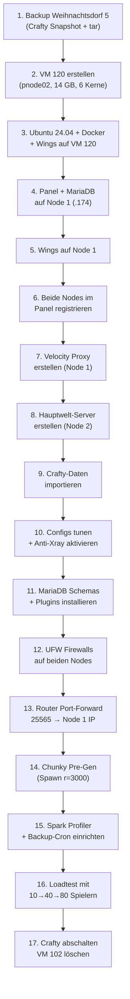

# Minecraft SMP Weihnachtsdorf – Pterodactyl Migration & 80-Player Tuning

> **Ziel**: Maximale TPS bei 80 Spielern (invite-only) am Spawn auf i5-9400F (6C/6T, 16 GB RAM).
> Keine Farmwelten. Ein Purpur-Server, ein Velocity-Proxy.

> [!IMPORTANT]
> **Weihnachtsdorf 7 – 100% Neueste Versionen (Upstream Fresh):**
> Keine Alt-Plugins oder alte Server-JARs aus Crafty (Weihnachtsdorf 5) übernehmen.
> Alle Komponenten werden direkt aus den neuesten Upstream-Quellen geladen:
> - **Server**: Neueste Minecraft / Purpur Version (Purpur 26.3 auf Java 25 LTS)
> - **Proxy**: Neueste Velocity Version
> - **Plugins**: Alle Plugins (LuckPerms, ViaVersion, ViaBackwards, Simple Voice Chat, Chunky, CoreProtect, Plan, EssentialsX, BlueMap, TAB) als frische Releases direkt von Hangar/Modrinth/GitHub.

---

## 1. Architektur

```
┌─────────── Internet ───────────┐
│        Port 25565 (TCP)        │
└──────────────┬─────────────────┘
               ▼
┌──────── Node 1 (pnode01/03) ───────────┐
│  Pterodactyl Panel + MariaDB + Redis    │
│  Wings (Docker):                        │
│  └─ Velocity Proxy (:25565) [512 MB]    │
└───────────────┬─────────────────────────┘
                │ LAN :25574
                ▼
┌──────── Node 2 (pnode02) ──────────────┐
│  Wings (Docker):                        │
│  └─ Purpur Hauptwelt (:25574)           │
│     Heap: 11 GB (-Xms11G -Xmx11G)      │
│     + Spark, Anti-Xray, Chunky Pre-Gen  │
│                                         │
│  Host: ~3 GB Headroom (OS+Docker+Off-H) │
└─────────────────────────────────────────┘
```

### RAM-Aufteilung Node 2 (16 GB physisch)

| Komponente | RAM |
|:---|:---|
| Proxmox Host | ~1.5 GB |
| Ubuntu VM OS + Wings/Docker | ~0.5 GB |
| Java Off-Heap (Metaspace, Netty, NIO, 80-Spieler-Buffers) | ~2.5 GB |
| **Purpur Heap (`-Xms11G -Xmx11G`)** | **11.0 GB** |
| **Reserve/Puffer** | **~0.5 GB** |

> [!IMPORTANT]
> VM 200 (Atlas-Gaming, 9 GB) **muss aus** während Minecraft läuft. Heap 11 GB statt 12 GB gibt dem Off-Heap bei 80 Spielern (Netty-Buffers, DirectByteBuffers) genug Luft.

---

## 2. Phase 1 – Node 2 VM erstellen

```bash
# Auf pnode02 als root:
qm create 120 \
  --name mc-main \
  --ostype l26 \
  --memory 14336 \
  --balloon 0 \
  --cores 6 \
  --sockets 1 \
  --cpu cputype=host \
  --net0 virtio,bridge=vmbr0 \
  --scsihw virtio-scsi-single \
  --scsi0 local-lvm:80,discard=on,iothread=1,ssd=1 \
  --ide2 local:iso/ubuntu-24.04.2-live-server-amd64.iso,media=cdrom \
  --boot order=scsi0\;ide2 \
  --start 0

qm set 120 --affinity 0-5
qm set 120 --startup order=1,up=30
```

> [!WARNING]
> VM 102 (Crafty) und VM 200 (Atlas) vorher stoppen.

### Ubuntu 24.04 Basis + Docker + Wings

```bash
apt update && apt upgrade -y
apt install -y curl tar unzip software-properties-common ufw

# Swap off:
swapoff -a && sed -i '/swap/d' /etc/fstab

# Kernel-Tuning:
cat >> /etc/sysctl.d/99-minecraft.conf << 'EOF'
net.core.rmem_max = 2500000
net.core.wmem_max = 2500000
vm.swappiness = 1
vm.max_map_count = 262144
EOF
sysctl --system

# Docker CE:
curl -fsSL https://get.docker.com | bash

# Wings:
mkdir -p /etc/pterodactyl
curl -Lo /usr/local/bin/wings \
  "https://github.com/pterodactyl/wings/releases/latest/download/wings_linux_amd64"
chmod +x /usr/local/bin/wings
```

Wings systemd Unit:

```ini
# /etc/systemd/system/wings.service
[Unit]
Description=Pterodactyl Wings Daemon
After=docker.service
Requires=docker.service

[Service]
User=root
WorkingDirectory=/etc/pterodactyl
LimitNOFILE=4096
PIDFile=/var/run/wings/daemon.pid
ExecStart=/usr/local/bin/wings
Restart=on-failure
StartLimitInterval=180
StartLimitBurst=30
RestartSec=5s

[Install]
WantedBy=multi-user.target
```

```bash
systemctl enable --now wings
```

---

## 3. Phase 2 – Node 1: Panel + Velocity

### 3.1 Pterodactyl Panel (auf usrv01 .174 oder eigene VM) <--- Kommentar von Mensch sicher nicht auf usrv01

```bash
apt install -y php8.3 php8.3-{cli,gd,mysql,pdo,mbstring,tokenizer,bcmath,xml,fpm,curl,zip} \
  mariadb-server nginx redis-server composer

mkdir -p /var/www/pterodactyl && cd /var/www/pterodactyl
curl -Lo panel.tar.gz https://github.com/pterodactyl/panel/releases/latest/download/panel.tar.gz
tar -xzvf panel.tar.gz
chmod -R 755 storage/* bootstrap/cache/

# MariaDB:
mysql -u root -e "
  CREATE DATABASE panel;
  CREATE USER 'pterodactyl'@'127.0.0.1' IDENTIFIED BY '<SICHERES_PASSWORT>';
  GRANT ALL PRIVILEGES ON panel.* TO 'pterodactyl'@'127.0.0.1' WITH GRANT OPTION;
  FLUSH PRIVILEGES;
"

cp .env.example .env
composer install --no-dev --optimize-autoloader
php artisan key:generate --force
php artisan p:environment:setup
php artisan migrate --seed --force
php artisan p:user:make
```

### 3.2 Wings auf Node 1 + Velocity Server

Wings installieren (gleiche Schritte wie Node 2). Dann im Panel:

1. Admin → Locations → `Homelab`
2. Admin → Nodes: **Node 1** (4 GB, 50 GB Disk) + **Node 2** (14 GB, 80 GB Disk)
3. Auf jeder Node: `wings configure --panel-url https://panel.tigimax.mooo.com --token <TOKEN> --node <ID>`

**Velocity Proxy erstellen** (Panel → Server → Create):
- Egg: Velocity, Node: Node 1, RAM: 512 MB, Port: 25565

**`velocity.toml`**:

```toml
config-version = "2.7"
bind = "0.0.0.0:25565"
motd = "<aqua>Weihnachtsdorf SMP</aqua>"
show-max-players = 80
online-mode = true
player-info-forwarding-mode = "modern"
forwarding-secret-file = "forwarding.secret"

[servers]
hauptwelt = "192.168.1.<NODE2>:25574"
try = ["hauptwelt"]

[forced-hosts]
"play.tigimax.mooo.com" = ["hauptwelt"]

[advanced]
compression-threshold = 256
compression-level = 6
login-ratelimit = 3000
connection-timeout = 5000
read-timeout = 30000
tcp-fast-open = true
bungee-plugin-message-channel = true
```

**Velocity Plugins:**

| Plugin | Zweck |
|:---|:---|
| LuckPerms Velocity | Rechte-Sync |
| ViaVersion + ViaBackwards | Version-Kompatibilität |
| LibertyBans (Velocity) | Cross-Server Bans |
| TAB (Velocity) | Einheitliche Tablist |
| SignedVelocity | Signed-Chat-Forwarding |
| MiniMOTD | Dynamisches MOTD |
| Maintenance | Wartungsmodus |

---

## 4. Phase 3 – Crafty → Pterodactyl Migration

### 4.1 Backup + Transfer

```bash
# Auf usrv03 (.147):
cd /var/opt/minecraft/crafty/crafty-4/servers
tar -czf /home/tigimax/weihnachtsdorf5_full_backup.tar.gz \
  d1edce29-757a-4fd0-806d-6e5d378497b7/

scp /home/tigimax/weihnachtsdorf5_full_backup.tar.gz \
  tigimax@<NODE2_IP>:/tmp/
```

### 4.2 Pterodactyl-Server erstellen + Daten importieren

Im Panel → Server → Create:
- Name: **Weihnachtsdorf 7**, Node: **Node 2**, Egg: **Purpur**
- Memory: **11264 MB**, Disk: **60000 MB**, CPU: **600%**
- Startup: `java -Xms11G -Xmx11G ... -jar server.jar`

```bash
# Auf Node 2 als root:
tar -xzf /tmp/weihnachtsdorf5_full_backup.tar.gz -C /tmp/mc-import/

CONTAINER_UUID=$(mysql -u pterodactyl -p panel \
  -e "SELECT uuid FROM servers WHERE name='Weihnachtsdorf 7'" -sN)
TARGET="/var/lib/pterodactyl/volumes/${CONTAINER_UUID}"

cp -a /tmp/mc-import/d1edce29-*/* "${TARGET}/"
chown -R 988:988 "${TARGET}/"
```

### 4.3 Post-Migration Checkliste

- [ ] `server.properties` → `server-port=25574`, `online-mode=false`
- [ ] `spigot.yml` → `bungeecord: true`
- [ ] `paper-global.yml` → `velocity.enabled: true`, `velocity.secret: <SECRET>`
- [ ] Welt-Integrität: `/tp 0 100 0` → Spawn laden
- [ ] Alle Plugins testen

---

## 5. Phase 4 – Firewall & Sicherheit

### Node 2 (mc-main VM)

```bash
ufw default deny incoming
ufw default allow outgoing
ufw allow from 192.168.1.x to any port 25574 proto tcp comment "Velocity→Hauptwelt"
ufw allow from 192.168.1.x to any port 8080 proto tcp comment "Panel→Wings API"
ufw allow from 192.168.1.x to any port 2022 proto tcp comment "Panel→Wings SFTP"
ufw allow from 192.168.1.0/24 to any port 22 proto tcp comment "SSH LAN"
ufw enable
```

### Node 1

```bash
ufw default deny incoming
ufw default allow outgoing
ufw allow 25565/tcp comment "Minecraft WAN (Velocity)"
ufw allow 443/tcp comment "Pterodactyl Panel HTTPS"
ufw allow from 192.168.1.0/24 to any port 8080 proto tcp comment "Wings API intern"
ufw allow from 192.168.1.0/24 to any port 2022 proto tcp comment "Wings SFTP intern"
ufw allow from 192.168.1.0/24 to any port 22 proto tcp comment "SSH LAN"
ufw enable
```

> [!CAUTION]
> **Kein WAN-Port-Forward auf Node 2.** Der einzige WAN-exponierte Port ist `25565` auf Node 1.

### Anti-UUID-Spoofing

Velocity `modern` Forwarding + HMAC → strukturell unmöglich. Auf ALLEN Backends:

```yaml
# paper-global.yml
proxies:
  velocity:
    enabled: true
    online-mode: true
    secret: "<IDENTISCHES_SECRET>"
```

---

## 6. Phase 5 – Aggressives Config-Tuning

> [!IMPORTANT]
> Radikal auf 80 Spieler am selben Ort optimiert. Event ist invite-only.

### 6.1 `server.properties`

```properties
view-distance=6
simulation-distance=4
network-compression-threshold=256
max-players=80
allow-flight=true
server-port=25574
online-mode=false
spawn-protection=0
entity-broadcast-range-percentage=75
```

### 6.2 `spigot.yml`

```yaml
settings:
  save-user-cache-on-stop-only: true
  moved-wrongly-threshold: 0.0625
  moved-too-quickly-multiplier: 10.0
  netty-threads: 4
  bungeecord: true

world-settings:
  default:
    entity-activation-range:
      animals: 16
      monsters: 24
      raiders: 32
      misc: 8
      water: 8
      villagers: 16
      flying-monsters: 32
      tick-inactive-villagers: false
      wake-up-inactive:
        animals-max-per-tick: 2
        animals-every: 1200
        animals-for: 100
        monsters-max-per-tick: 4
        monsters-every: 400
        monsters-for: 100
        villagers-max-per-tick: 1
        villagers-every: 2400
        villagers-for: 100
    merge-radius:
      item: 4.0
      exp: 6.0
    item-despawn-rate: 4000
    mob-spawn-range: 4
    nerf-spawner-mobs: true
    entity-tracking-range:
      players: 96
      animals: 48
      monsters: 48
      misc: 32
      display: 96
      other: 48
    hopper-transfer: 8
    hopper-check: 8
    hopper-amount: 3
```

### 6.3 `paper-global.yml`

```yaml
chunk-loading-basic:
  autoconfig-send-distance: true
  player-max-chunk-generate-rate: 5.0
  player-max-chunk-load-rate: 50.0
  player-max-chunk-send-rate: 40.0

chunk-loading-advanced:
  auto-config-send-distance: true
  player-max-concurrent-chunk-generates: 2
  player-max-concurrent-chunk-loads: 4

chunk-system:
  gen-parallelism: default
  io-threads: 2
  worker-threads: 2

packet-limiter:
  all-packets:
    action: DROP
    interval: 7.0
    max-packet-rate: 500.0
  overrides:
    ServerboundPlaceRecipePacket:
      action: DROP
      interval: 4.0
      max-packet-rate: 5.0

proxies:
  velocity:
    enabled: true
    online-mode: true
    secret: "<FORWARDING_SECRET>"

anticheat:
  anti-xray:
    enabled: true
    engine-mode: 2
    hidden-blocks:
      - copper_ore
      - deepslate_copper_ore
      - raw_copper_block
      - gold_ore
      - deepslate_gold_ore
      - iron_ore
      - deepslate_iron_ore
      - raw_iron_block
      - coal_ore
      - deepslate_coal_ore
      - lapis_ore
      - deepslate_lapis_ore
      - mossy_cobblestone
      - obsidian
      - chest
      - diamond_ore
      - deepslate_diamond_ore
      - redstone_ore
      - deepslate_redstone_ore
      - clay
      - emerald_ore
      - deepslate_emerald_ore
      - ender_chest
    lava-obscures: false
    max-block-height: 64
    replacement-blocks:
      - amethyst_block
      - andesite
      - budding_amethyst
      - calcite
      - coal_ore
      - deepslate_coal_ore
      - deepslate
      - diorite
      - dirt
      - emerald_ore
      - deepslate_emerald_ore
      - granite
      - gravel
      - iron_ore
      - deepslate_iron_ore
      - oak_planks
      - smooth_basalt
      - stone
      - tuff
    update-radius: 2
    use-permission: false

async-chunks:
  threads: 2
```

> [!NOTE]
> **Anti-Xray Engine Mode 2** (Obfuscation) ist der beste X-Ray-Schutz: Zero-Plugin, in Paper eingebaut, minimaler CPU-Overhead. Ersetzt jedes Anti-Xray-Plugin. Funktioniert server-seitig – kein Client-Mod kann das umgehen.

### 6.4 `paper-world-defaults.yml`

```yaml
entities:
  armor-stands:
    do-collision-entity-lookups: false
    tick: false
  markers:
    tick: false
  spawning:
    despawn-ranges:
      ambient:
        hard: 56
        soft: 28
      axolotls:
        hard: 56
        soft: 28
      creature:
        hard: 56
        soft: 28
      misc:
        hard: 56
        soft: 28
      monster:
        hard: 56
        soft: 28
      underground_water_creature:
        hard: 40
        soft: 20
      water_ambient:
        hard: 40
        soft: 20
      water_creature:
        hard: 48
        soft: 24
    per-player-mob-spawns: true
    global-max-concurrent-loads: 500
    player-max-concurrent-loads: 20
    count-all-mobs-for-spawning: true
  behavior:
    ender-dragons-death-always-places-dragon-egg: true
    disable-mob-spawner-spawn-egg-transformation: true
    pillager-patrols:
      disable: true
      spawn-chance: 0.0
      spawn-delay:
        per-player: true
        ticks: 24000
    phantoms:
      do-not-spawn-on-creative-players: true
      only-attack-insomniacs: true

environment:
  treasure-maps:
    enabled: false
    find-already-discovered:
      loot-tables: true
      villager-trade: true
  optimize-explosions: true
  disable-teleportation-suffocation-check: true
  water-over-lava-flow-speed: 5
  nether-ceiling-void-damage-height: 127

hopper:
  cooldown-when-full: true
  disable-move-event: true
  ignore-occluding-blocks: true

chunks:
  auto-save-interval: 6000
  delay-chunk-unloads-by: 10s
  entity-per-chunk-save-limit:
    arrow: 8
    ender_pearl: 8
    experience_orb: 16
    fireball: 4
    small_fireball: 4
    snowball: 4
  max-auto-save-chunks-per-tick: 8
  prevent-moving-into-unloaded-chunks: true
  fixed-chunk-inhabited-time: -1

collisions:
  fix-climbing-bypassing-cramming-rule: true
  max-entity-collisions: 2
  only-players-collide: true

tick-rates:
  behavior:
    villager:
      validatenearbypoi: -1
      acquirepoi: 120
  container-update: 3
  grass-spread: 4
  mob-spawner: 4
  sensor:
    villager:
      secondarypoisensor: 200
      nearestbedsensor: 200
      villagerbabiessensor: 200
      playersensor: 200
      nearestlivingentitysensor: 200

spawn-limits:
  ambient: 1
  axolotls: 2
  creature: 3
  monster: 20
  underground_water_creature: 2
  water_ambient: 2
  water_creature: 2

misc:
  redstone-implementation: ALTERNATE_CURRENT
  update-pathfinding-on-block-update: false
  disable-chest-cat-detection: true
  armor-stands-tick: false

maps:
  item-frame-cursor-limit: 2
  item-frame-cursor-update-interval: 20

scoreboards:
  save-empty-scoreboard-teams: false
```

### 6.5 `purpur.yml`

```yaml
settings:
  dont-send-useless-entity-packets: true
  use-alternate-keepalive: true
  tps-catchup:
    enabled: false
  lagging-threshold: 16.0
  network:
    max-joins-per-tick: 3

world-settings:
  default:
    blocks:
      bed:
        explode: false
        explode-effect: NONE
      respawn-anchor:
        explode: false
        explode-effect: NONE
      barrel:
        rows: 3
      ender-chest:
        six-rows: true

    mobs:
      villager:
        lobotomize:
          enabled: true
          check-interval: 100
        search-radius:
          acquire-poi: 16
          nearest-bed-sensor: 16
        brain-ticks: 4
        spawn-iron-golem:
          radius: 0
        can-breed: false
        clerics-farm-warts: false
        cleric-wart-farmers-throw-warts-at-villagers: false
      zombie:
        aggressive-towards-villager-when-lagging: false
      phantom:
        spawn:
          min-sky-darkness: 15
          only-above-sea-level: true
          min-time-since-slept: 96000
      pillager:
        bypass-mob-griefing: true
      iron-golem:
        can-swim: false
      dolphin:
        disable-treasure-searching: true
      ender-dragon:
        always-drop-full-exp: true

    gameplay-mechanics:
      entities-can-use-portals: false
      player:
        idle-timeout:
          kick-if-idle: true
          tick-nearby-entities: false
          count-as-sleeping: true
          update-tab-list: true
        teleport-if-outside-border: true
      item:
        immune:
          cactus: []
          explosion: []
          fire: []
          lightning: []
      armorstand-step-height: 0.0
      disable-drops-on-cramming-death: true
      use-better-mending: true
      impose-teleport-restrictions-on-gateways: true

    entity-per-chunk-save-limit:
      experience_orb: 16
      arrow: 8
      ender_pearl: 8
      snowball: 4
```

### 6.6 `bukkit.yml`

```yaml
spawn-limits:
  monsters: 20
  animals: 3
  water-animals: 2
  water-ambient: 2
  water-underground-creature: 2
  axolotls: 2
  ambient: 1

ticks-per:
  animal-spawns: 400
  monster-spawns: 4
  water-spawns: 400
  water-ambient-spawns: 400
  water-underground-creature-spawns: 400
  axolotl-spawns: 400
  ambient-spawns: 400
  autosave: 6000
```

---

## 7. Phase 6 – Plugins

### Hauptwelt-Plugins (Node 2)

| Plugin | Zweck |
|:---|:---|
| **Spark** | Performance-Monitoring, TPS/MSPT, CPU-Profiling, GC-Analyse |
| **Chunky** | Spawn-Bereich Pre-Generation (vor Event!) |
| **LuckPerms** | Rechte (MariaDB-Backend) |
| **EssentialsX** | Teleport, Homes, Warps, Chat |
| **CoreProtect** | Block-Logging (MariaDB-Backend) |
| **Plan** | Analytics (MariaDB-Backend) |
| **DiscordSRV** | Discord-Integration |
| **BlueMap** | Dynmap-Alternative (bereits vorhanden) |

> [!IMPORTANT]
> **Anti-Xray wird NICHT als Plugin gelöst** sondern über Paper's eingebauten `engine-mode: 2` (siehe 6.3). Zero Overhead, nicht umgehbar. Kein Grim/Vulcan nötig – Event ist Whitelist-only.

### Chunky Pre-Gen (vor dem Event ausführen!)

```
/chunky center 0 0
/chunky radius 3000
/chunky start
```

Danach Chunky entfernen oder deaktivieren – es wird nur für die Vorgenerierung gebraucht.

### MariaDB-Schemas (auf Node 1)

```sql
CREATE DATABASE mc_luckperms;
CREATE DATABASE mc_coreprotect;
CREATE DATABASE mc_plan;
CREATE USER 'minecraft'@'192.168.1.%' IDENTIFIED BY '<PASSWORT>';
GRANT ALL ON mc_luckperms.* TO 'minecraft'@'192.168.1.%';
GRANT ALL ON mc_coreprotect.* TO 'minecraft'@'192.168.1.%';
GRANT ALL ON mc_plan.* TO 'minecraft'@'192.168.1.%';
FLUSH PRIVILEGES;
```

---

## 8. Phase 7 – JVM-Flags

Aikar's Flags, angepasst für 11 GB Heap:

```bash
java -Xms11G -Xmx11G \
  -XX:+UseG1GC \
  -XX:+ParallelRefProcEnabled \
  -XX:MaxGCPauseMillis=130 \
  -XX:+UnlockExperimentalVMOptions \
  -XX:+DisableExplicitGC \
  -XX:+AlwaysPreTouch \
  -XX:G1NewSizePercent=40 \
  -XX:G1MaxNewSizePercent=50 \
  -XX:G1HeapRegionSize=16M \
  -XX:G1ReservePercent=15 \
  -XX:G1MixedGCCountTarget=4 \
  -XX:InitiatingHeapOccupancyPercent=20 \
  -XX:G1MixedGCLiveThresholdPercent=90 \
  -XX:G1RSetUpdatingPauseTimePercent=5 \
  -XX:SurvivorRatio=32 \
  -XX:+PerfDisableSharedMem \
  -XX:MaxTenuringThreshold=1 \
  -Dusing.aikars.flags=https://mcflags.emc.gs \
  -Daikars.new.flags=true \
  -jar server.jar --nogui
```

> [!NOTE]
> `G1NewSizePercent=40`, `G1MaxNewSizePercent=50`, `G1HeapRegionSize=16M` – angepasst für Heaps ≥10 GB, verhindert konservatives Collection und Full-GC-Pausen.

---

## 9. Phase 8 – Backup & Auto-Restart

### Welt-Backup (Cron auf Node 2 VM)

```bash
# /usr/local/bin/mc-backup.sh
#!/bin/bash
WORLD_DIR="/var/lib/pterodactyl/volumes/<CONTAINER_UUID>"
BACKUP_DIR="/opt/mc-backups"
mkdir -p "$BACKUP_DIR"

# Stündliches Rotations-Backup (letzte 6 behalten)
STAMP=$(date +%H)
tar czf "${BACKUP_DIR}/world_${STAMP}.tar.gz" \
  -C "$WORLD_DIR" world/ world_nether/ world_the_end/ 2>/dev/null

# Alte Backups aufräumen (>6 Stunden)
find "$BACKUP_DIR" -name "world_*.tar.gz" -mmin +360 -delete
```

```bash
chmod +x /usr/local/bin/mc-backup.sh
echo "0 * * * * root /usr/local/bin/mc-backup.sh" >> /etc/crontab
```

### Täglicher Auto-Restart (05:00 Uhr)

Über Pterodactyl Schedule (Panel → Server → Schedules):
1. **04:50** – Send Command: `say Server startet in 10 Minuten neu!`
2. **04:55** – Send Command: `say Server startet in 5 Minuten neu!`
3. **05:00** – Send Power Action: **Restart**

---

## 10. Checkliste & Reihenfolge



| Schritt | Abhängig von | Dauer |
|:---|:---|:---|
| 1. Backup | – | 10 min |
| 2. VM erstellen | 1 | 5 min |
| 3. OS + Docker + Wings | 2 | 30 min |
| 4. Panel + DB | – (parallel zu 2-3) | 45 min |
| 5. Wings Node 1 | 4 | 15 min |
| 6. Nodes registrieren | 3, 5 | 10 min |
| 7. Velocity Proxy | 6 | 15 min |
| 8. Hauptwelt-Server | 6 | 10 min |
| 9. Daten-Import | 1, 8 | 15 min |
| 10. Config-Tuning | 9 | 20 min |
| 11. SQL + Plugins | 4, 10 | 30 min |
| 12. Firewalls | 7, 8 | 10 min |
| 13. Port-Forward | 12 | 5 min |
| 14. Chunky Pre-Gen | 10 | 30-60 min (läuft im Hintergrund) |
| 15. Spark + Backup | 10 | 10 min |
| 16. Loadtest | 13, 14 | laufend |
| 17. Crafty decom | 16 | 10 min |
| **Gesamt** | | **~4 Stunden** |

> [!TIP]
> Schritte 2-3 und 4-5 können parallel laufen (~30 Min gespart). Chunky Pre-Gen läuft im Hintergrund während du Plugins konfigurierst.
