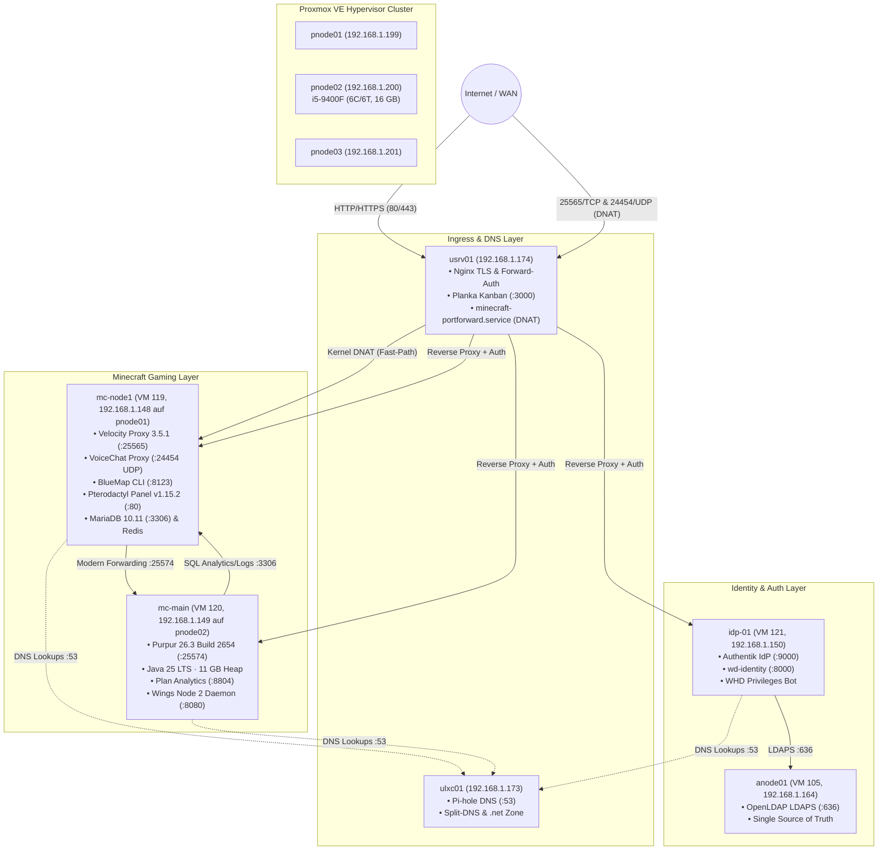
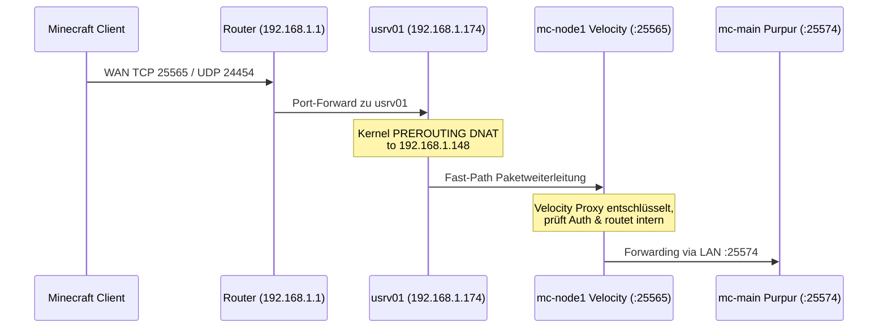

# Weihnachtsdorf 7 • Network, DNS & Firewall Architecture Guide

**Version**: 1.0.0  
**Status**: Produktiv & Verifiziert ✅  
**Letzte Aktualisierung**: 2026-10-28  

---

## 1. Übersicht & Host-Topologie

Das Netzwerk des **Minecraft SMP Weihnachtsdorf 7** ist als mehrschichtige, hochverfügbare Homelab-Architektur ausgelegt. Es trennt öffentlichen Ingress-Traffic, TLS-Terminierung, Authentifizierung, Gaming-Traffic und Datenbanken sauber voneinander.

### 🗺️ Vollständige Host-Übersicht



| Host / VM-ID | IP-Adresse | Rolle / Betriebssystem | Hauptdienste & Ports |
|---|---|---|---|
| **`pnode01`** | `192.168.1.199` | Proxmox VE 8.x Host | Hostet VM 119 (`mc-node1`) |
| **`pnode02`** | `192.168.1.200` | Proxmox VE 8.x Host | Hostet VM 120 (`mc-main`), dedizierte Cores 0–5 |
| **`pnode03`** | `192.168.1.201` | Proxmox VE 8.x Host | Quorum, Backups & Failover |
| **`usrv01`** | `192.168.1.174` | Ubuntu 22.04 LTS (Bare/VM) | Nginx Ingress, TLS, Authentik Forward-Auth Outpost, Planka (:3000), `minecraft-portforward.service` (DNAT) |
| **`ulxc01`** | `192.168.1.173` | Ubuntu 22.04 LTS (LXC) | Pi-hole DNS (Port 53 TCP/UDP), Split-DNS & interne `.net` Zone |
| **`mc-node1`** (VM 119) | `192.168.1.148` | Ubuntu 24.04 LTS (VM) | Velocity 3.5.1 (:25565), VoiceChat (:24454 UDP), BlueMap (:8123), Pterodactyl Panel (:80), Wings (:8080, :2022), MariaDB (:3306), Redis (:6379) |
| **`mc-main`** (VM 120) | `192.168.1.149` | Ubuntu 24.04 LTS (VM) | Purpur 26.3 (:25574), Plan Analytics (:8804), Wings Node 2 (:8080, :2022) |
| **`idp-01`** (VM 121) | `192.168.1.150` | Ubuntu 24.04 LTS (VM) | Authentik IdP (:9000), `wd-identity` (:8000), Discord-Bot `WHD Privileges`, PostgreSQL 16 |
| **`anode01`** (VM 105) | `192.168.1.164` | Ubuntu 24.04 LTS (VM) | OpenLDAP 2.5 (LDAPS :636), `wdAccount` Schema, Ansible Control Node |

---

## 2. Ingress & Reverse Proxy (`usrv01`)

Der Host `usrv01` (`192.168.1.174`) fungiert als zentrales Eingangstor für sämtlichen externen Web-Traffic und stellt TLS-Terminierung via Let's Encrypt sowie Authentik Forward-Auth bereit.

### 🌐 Öffentliche Endpunkte & Routing

| Öffentliche Domain | Protokoll | Backend-Ziel | Authentifizierung / Schutz |
|---|---|---|---|
| `auth.tigimax.mooo.com` | HTTPS :443 | `http://192.168.1.150:9000` | Authentik IdP Portal (Direktzugriff) |
| `panel.tigimax.mooo.com` | HTTPS :443 | `http://192.168.1.148:80` | Forward-Auth Outpost (`wd-panel`) + Bypass für Wings API |
| `map.tigimax.mooo.com` | HTTPS :443 | `http://192.168.1.148:8123` | Forward-Auth Outpost (`wd-bluemap`), HTTP-HEAD Rewriting |
| `plan.tigimax.mooo.com` | HTTPS :443 | `http://192.168.1.149:8804` | Forward-Auth Outpost (`wd-plan`) |
| `tigimax.mooo.com` | HTTPS :443 | `http://127.0.0.1:3000` | Forward-Auth Outpost (`wd-planka`) + WebSocket Upgrade |
| `panel.tigimax.mooo.com:8081` | HTTPS :8081 | `http://192.168.1.148:8080` | TLS-Proxy für Wings Node 1 API |
| `panel.tigimax.mooo.com:8082` | HTTPS :8082 | `http://192.168.1.149:8080` | TLS-Proxy für Wings Node 2 API |

> [!WARNING]
> **FreeDNS 6-Monats-Verfallsregel (`mooo.com`)**:  
> Die öffentliche Zone `*.tigimax.mooo.com` wird über Dynamic DNS von [FreeDNS (afraid.org)](https://freedns.afraid.org/) verwaltet. Unbenutzte oder nicht aktualisierte Subdomains verfallen alle 6 Monate automatisch. Bei plötzlichen WAN-Ausfällen der externen Namen muss der Betreiber die Records auf freedns.afraid.org prüfen und reaktivieren.

### 🔐 Authentik Forward-Auth Architektur

Alle internen Webservices (`panel`, `map`, `plan`, `tigimax.mooo.com`) binden die Authentik Forward-Auth Snippets ein:

```nginx
# /etc/nginx/snippets/authentik-forward-auth.conf
location /outpost.goauthentik.io {
    proxy_pass              http://192.168.1.150:9000/outpost.goauthentik.io;
    proxy_http_version      1.1;
    proxy_set_header        Host $http_host;
    proxy_set_header        X-Original-URL $scheme://$http_host$request_uri;
}

location = /outpost.goauthentik.io/auth/nginx {
    internal;
    proxy_pass              http://192.168.1.150:9000/outpost.goauthentik.io/auth/nginx;
    proxy_pass_request_body off;
    proxy_set_header        Content-Length "";
}
```

Wenn ein nicht authentifizierter Benutzer ein Portal aufruft, sendet Nginx einen internen `auth_request` an Authentik. Schlägt dieser mit HTTP 401 fehl, leitet `@authentik_signin` den Browser automatisch per HTTP 302 auf `https://auth.tigimax.mooo.com` um. Nach erfolgreichem Login wird ein bereichsübergreifendes Session-Cookie für die Domain `.tigimax.mooo.com` gesetzt (**Single Sign-On**).

### ⚡ Spezifische Ingress-Bypasses & Rewrites

1. **Pterodactyl Wings API Bypass (`/api/remote/`)**:
   Die Wings-Daemons auf Node 1 und Node 2 kommunizieren per API-Token mit dem Panel. In `configs/nginx/panel.conf` ist dieser Pfad explizit geschützt:
   ```nginx
   location /api/remote/ {
       auth_request off;
       proxy_pass http://192.168.1.148:80;
   }
   ```
2. **Wings WebSocket Konsolen-Bypass**:
   Die interaktiven Serverkonsolen der UUIDs `8651ca23` (Velocity) und `a173d02e` (Purpur) leiten WebSocket-Verbindungen direkt an Port 8080 der jeweiligen Node weiter (`auth_request off;`).
3. **BlueMap HTTP HEAD Rewriting (`configs/nginx/map.conf`)**:
   Der integrierte BlueMap Webserver unterstützt nur `GET` und `POST` und quittiert `HEAD`-Requests mit HTTP 400. Nginx wandelt client-seitige HEAD-Requests via `$bluemap_method` transparent in ein upstream-`GET` um:
   ```nginx
   map $request_method $bluemap_method {
       HEAD GET;
       default $request_method;
   }
   ```

---

## 3. Kernel Port Forwarding & DNAT (`minecraft-portforward.service`)

Für Minecraft und Simple Voice Chat ist HTTP-Reverse-Proxying ungeeignet, da Latenzen minimal und UDP-Audio-Pakete bitgenau transportiert werden müssen.

Auf `usrv01` (`192.168.1.174`) leitet der Systemd-Dienst **`minecraft-portforward.service`** eingehende Spielerverbindungen direkt über den Linux-Kernel (Netfilter/iptables DNAT) an `mc-node1` weiter.

### ⚙️ Funktionsweise des Kernel DNAT



### Systemd Service Konfiguration (`/etc/systemd/system/minecraft-portforward.service`)

```ini
[Unit]
Description=Minecraft TCP/UDP Kernel Port Forwarding to mc-node1
After=network.target

[Service]
Type=oneshot
RemainAfterExit=yes
ExecStart=/sbin/sysctl -w net.ipv4.ip_forward=1
ExecStart=/sbin/iptables -t nat -A PREROUTING -p tcp --dport 25565 -j DNAT --to-destination 192.168.1.148:25565
ExecStart=/sbin/iptables -t nat -A PREROUTING -p udp --dport 24454 -j DNAT --to-destination 192.168.1.148:24454
ExecStart=/sbin/iptables -t nat -A POSTROUTING -d 192.168.1.148 -p tcp --dport 25565 -j MASQUERADE
ExecStart=/sbin/iptables -t nat -A POSTROUTING -d 192.168.1.148 -p udp --dport 24454 -j MASQUERADE

ExecStop=/sbin/iptables -t nat -D PREROUTING -p tcp --dport 25565 -j DNAT --to-destination 192.168.1.148:25565
ExecStop=/sbin/iptables -t nat -D PREROUTING -p udp --dport 24454 -j DNAT --to-destination 192.168.1.148:24454
ExecStop=/sbin/iptables -t nat -D POSTROUTING -d 192.168.1.148 -p tcp --dport 25565 -j MASQUERADE
ExecStop=/sbin/iptables -t nat -D POSTROUTING -d 192.168.1.148 -p udp --dport 24454 -j MASQUERADE

[Install]
WantedBy=multi-user.target
```

**Vorteile des Kernel-DNAT:**
- **Zero Overhead**: Keine Kontextwechsel in den User-Space wie bei Nginx Stream oder HAProxy.
- **UDP Jitter-Frei**: Proximity Voice Chat über UDP 24454 behält exaktes Paket-Timing ohne Puffer-Latenzen.
- **Failover-Sicherheit**: Überlebt Nginx-Neustarts und Konfigurations-Reloads unberührt.

---

## 4. Pi-hole DNS & Split-DNS (`ulxc01`)

Auf `ulxc01` (`192.168.1.173`) läuft der zentrale DNS-Server (Pi-hole im Docker-Container). Er übernimmt zwei essenzielle Aufgaben:
1. **Interne `.net` Namensauflösung**: Alle Server im Homelab können über kurze Hostnamen (`mc-node1.net`, `mc-main.net`, `idp-01.net`) kommunizieren.
2. **Split-DNS für `*.tigimax.mooo.com`**: Verhindert NAT-Loopback-Probleme im lokalen Netz. Interne Clients erhalten sofort die lokale IP von `usrv01` (`192.168.1.174`) bzw. `mc-node1` (`192.168.1.148`), ohne über den Internet-Router geroutet zu werden.

### 📁 Source of Truth: `configs/pihole/custom.list`

Die Datei [`configs/pihole/custom.list`](../configs/pihole/custom.list) im Git-Repository ist die verbindliche **Single Source of Truth** für alle DNS-Zuweisungen.

Auszug der relevanten Weihnachtsdorf-Einträge:
```text
# Minecraft Gaming Nodes
192.168.1.148 mc-node1.net
192.168.1.148 mc-node1
192.168.1.148 velocity.net
192.168.1.148 mc.net
192.168.1.148 play.net
192.168.1.148 mc.tigimax.mooo.com
192.168.1.148 velocity.tigimax.mooo.com

192.168.1.149 mc-main.net
192.168.1.149 mc-main
192.168.1.149 purpur.net
192.168.1.149 weihnachtsdorf.net

# Ingress & Web Portale
192.168.1.174 usrv01.net
192.168.1.174 panel.tigimax.mooo.com
192.168.1.174 auth.tigimax.mooo.com
192.168.1.174 map.tigimax.mooo.com
192.168.1.174 plan.tigimax.mooo.com
192.168.1.174 tigimax.mooo.com

# Identity & LDAP
192.168.1.150 idp-01.net
192.168.1.150 authentik.net
192.168.1.164 anode01.net
192.168.1.164 ldap.net
```

### 🤖 Ansible Deployment Playbook

Die Aktualisierung des DNS erfolgt vollautomatisch über das Playbook [`ansible/playbooks/configure_pihole_dns.yml`](../ansible/playbooks/configure_pihole_dns.yml):

```bash
# DNS auf Pi-hole ausrollen & validieren
ansible-playbook -i ansible/inventory.ini ansible/playbooks/configure_pihole_dns.yml
```

**Sicherheitsmechanismen des Playbooks:**
1. **Automatisches Backup**: Vor jeder Änderung wird auf `ulxc01` eine Kopie mit Timestamp angelegt (`custom.list.bak_YYYYMMDD_HHMMSS`).
2. **Handler Reload**: Triggert `docker exec pihole pihole restartdns reload`.
3. **Automatisierte Validierung**: Prüft via `getent hosts`, ob alle 8 kritischen Domänen (`mc-node1.net`, `mc-main.net`, `idp-01.net`, `auth`, `panel`, `map`, `plan`, `tigimax.mooo.com`) sauber auflösen. Schlägt ein Lookup fehl, schlägt das Playbook mit Fehler fehl.

---

## 5. Firewall-Architektur & UFW / Docker Isolierung

Auf beiden Minecraft-Nodes (`mc-node1` und `mc-main`) läuft **UFW** mit einer gehärteten Default-Deny-Richtlinie.

### ⚠️ Das Docker-UFW Bypass Problem & DOCKER-USER Chains

> [!WARNING]
> Standardmäßig manipuliert Docker die iptables-Regeln direkt und leitet Port-Mappings an UFW vorbei! Ein Container mit `-p 8123:8123` wäre daher trotz `ufw default deny incoming` aus dem gesamten LAN erreichbar.

**Lösung**: Einsatz der offiziellen `DOCKER-USER` Filter-Chain in `/etc/ufw/after.rules`, gesteuert durch [`ansible/playbooks/configure_firewall.yml`](../ansible/playbooks/configure_firewall.yml).

#### Node 1 (`mc-node1`): BlueMap Schutz
```text
*filter
:DOCKER-USER - [0:0]
-A DOCKER-USER -i eth0 -p tcp --dport 8123 -s 192.168.1.174 -j ACCEPT
-A DOCKER-USER -i eth0 -p tcp --dport 8123 -j DROP
-A DOCKER-USER -j RETURN
COMMIT
```
*Wirkung*: BlueMap (Port 8123) darf **ausschließlich** von `usrv01` (Nginx mit Authentik Forward-Auth) aufgerufen werden. Direkte LAN-Zugriffe werden auf Kernel-Ebene verworfen.

#### Node 2 (`mc-main`): Purpur Backend & Plan Analytics Schutz
```text
*filter
:DOCKER-USER - [0:0]
-A DOCKER-USER -i eth0 -p tcp --dport 25574 -s 192.168.1.148 -j ACCEPT
-A DOCKER-USER -i eth0 -p udp --dport 25574 -s 192.168.1.148 -j ACCEPT
-A DOCKER-USER -i eth0 -p tcp --dport 25574 -j DROP
-A DOCKER-USER -i eth0 -p udp --dport 25574 -j DROP
-A DOCKER-USER -i eth0 -p tcp --dport 8804 -s 192.168.1.174 -j ACCEPT
-A DOCKER-USER -i eth0 -p tcp --dport 8804 -j DROP
-A DOCKER-USER -j RETURN
COMMIT
```
*Wirkung*:
- Port 25574 (Purpur) akzeptiert Verbindungen **ausschließlich** von `mc-node1` (Velocity Proxy). Kein Spieler kann Velocity umgehen und direkt auf das Backend verbinden.
- Port 8804 (Plan Analytics) akzeptiert HTTP-Traffic **ausschließlich** von `usrv01` (Nginx mit Authentik SSO). Direkte Zugriffe aus dem LAN werden abgewiesen.

### 🛡️ Vollständige Port- & Firewall-Matrix

| Node | Port / Protokoll | Erlaubte Quelle | Zweck |
|---|---|---|---|
| **`mc-node1`** | `22/tcp` | `192.168.1.0/24`, `10.8.0.0/24` | SSH-Zugriff aus Homelab LAN & VPN |
| **`mc-node1`** | `25565/tcp` | `0.0.0.0/0` (via Ingress DNAT) | Velocity Proxy Minecraft Ingress |
| **`mc-node1`** | `24454/udp` | `0.0.0.0/0` (via Ingress DNAT) | Simple Voice Chat Proxy |
| **`mc-node1`** | `80/tcp` | `192.168.1.174` (`usrv01`) | Pterodactyl Panel HTTP Backend |
| **`mc-node1`** | `8123/tcp` | `192.168.1.174` (`usrv01`) | BlueMap HTTP (DOCKER-USER gesichert) |
| **`mc-node1`** | `8080/tcp` | `192.168.1.174`, `127.0.0.1` | Wings Daemon API |
| **`mc-node1`** | `3306/tcp` | `192.168.1.149` (`mc-main`) | MariaDB für LuckPerms, CoreProtect & Plan |
| **`mc-node1`** | `2022/tcp` | `192.168.1.0/24`, `10.8.0.0/24` | Wings SFTP File Transfer |
| **`mc-main`** | `22/tcp` | `192.168.1.0/24`, `10.8.0.0/24` | SSH-Zugriff aus Homelab LAN & VPN |
| **`mc-main`** | `25574/tcp+udp` | `192.168.1.148` (`mc-node1` only) | Purpur 26.3 Backend (DOCKER-USER gesichert) |
| **`mc-main`** | `8080/tcp` | `192.168.1.148` (Panel), `192.168.1.174` | Wings Daemon API |
| **`mc-main`** | `8804/tcp` | `192.168.1.174` (`usrv01`) | Plan Analytics Webserver (DOCKER-USER gesichert) |
| **`mc-main`** | `2022/tcp` | `192.168.1.0/24`, `10.8.0.0/24` | Wings SFTP File Transfer |

---

## 6. Automatisierung & Verifikation

Die gesamte Netzwerk- und Firewall-Konfiguration kann mit Ansible reproduziert werden:

```bash
# 1. Firewall & Docker Chains auf allen Minecraft Nodes anwenden:
ansible-playbook -i ansible/inventory.ini ansible/playbooks/configure_firewall.yml

# 2. BlueMap Sync Timer auf Node 1 deployen:
ansible-playbook -i ansible/inventory.ini ansible/playbooks/setup_bluemap_sync.yml

# 3. Pi-hole DNS synchronisieren & verifizieren:
ansible-playbook -i ansible/inventory.ini ansible/playbooks/configure_pihole_dns.yml

# 4. Kernel- und Netzwerk-Tuning prüfen:
ansible-playbook -i ansible/inventory.ini ansible/playbooks/tune_mc_nodes.yml
```

### Verifikations-Befehle

```bash
# UFW Status & Docker Chain auf mc-node1 prüfen:
ssh tigimax@192.168.1.148 "sudo ufw status verbose && sudo iptables -L DOCKER-USER -n -v"

# UFW Status & Docker Chain auf mc-main prüfen:
ssh tigimax@192.168.1.149 "sudo ufw status verbose && sudo iptables -L DOCKER-USER -n -v"

# Kernel DNAT Status auf usrv01 prüfen:
ssh tigimax@192.168.1.174 "sudo iptables -t nat -L PREROUTING -n -v | grep -E '25565|24454'"

# DNS Namensauflösung im LAN testen:
dig @192.168.1.173 mc-node1.net +short
dig @192.168.1.173 panel.tigimax.mooo.com +short
```

---

## 7. Verwandte Dokumentationen

- 📖 [Admin & Operations Handbook](admin_operations_handbook.md) – Praktische Wartung, Logs & Notfallprozeduren.
- 🔐 [Identity, SSO, LDAP & Discord Guide](identity_sso_ldap_discord_guide.md) – Single Sign-On, Authentik & LDAP.
- 🦖 [Phase 2 Pterodactyl Deployment Report](phase2_pterodactyl_deployment_report.md) – Deployment-Report und Performance-Messwerte.
