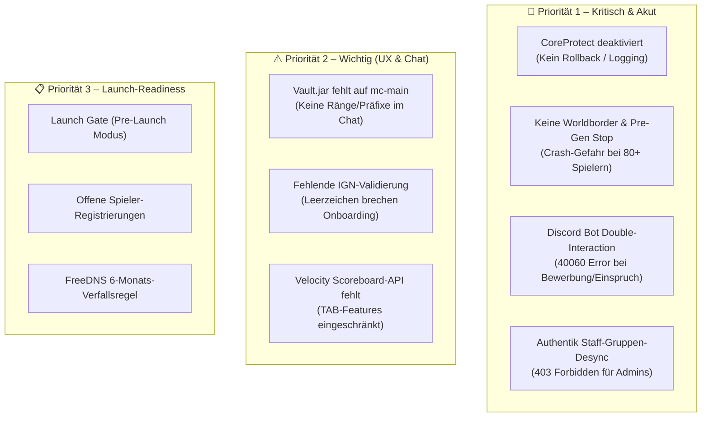

# Weihnachtsdorf 7 • Offene Probleme, Risiken & Action Items

**Stand**: 2026-10-28  
**Gültig für**: Minecraft SMP Weihnachtsdorf 7 (Purpur 26.3 / Velocity 3.5.1 / Authentik / OpenLDAP)  
**Status**: Audit & Analyse der laufenden Produktivumgebung

---

## 📊 Status-Übersicht



---

## 🚨 Priorität 1: Kritisch & Akut (Funktionseinschränkung & Crash-Risiko)

### 1. CoreProtect ist komplett deaktiviert (Minecraft 26.3 Inkompatibilität)

* **Problem**:  
  Beim Starten von Purpur auf `mc-main` schlägt der Versionscheck von CoreProtect fehl und das Plugin entlädt sich vollständig:
  ```text
  [CoreProtect] Enabling CoreProtect v24.1
  [CoreProtect] Minecraft 26.3 is not supported.
  [CoreProtect] CoreProtect Community Edition was unable to start.
  [CoreProtect] Disabling CoreProtect v24.1
  [CoreProtect] Finishing up data logging. Please wait...
  [CoreProtect] Success! Disabled CoreProtect v24.1
  ```
* **Auswirkung**:  
  Es werden **keinerlei Block-Platzierungen, Zerstörungen, Kisten-Transaktionen oder Morde geloggt**. Der Befehl `/co rollback` sowie der Inspector `/co inspect` sind inoperabel. Sollte ein Spieler am Spawn oder an Bauwerken griefen, können Moderatoren den Schaden weder nachverfolgen noch rückgängig machen.
* **Ursache**:  
  In `CoreProtect.jar` prüft die Klasse `net.coreprotect.services.VersionCheckService` (Bytecode-Offset 152) strikt gegen die Version `26.2`:
  ```java
  if (VersionUtils.newVersion("26.2", serverVersion) && VersionUtils.isCommunityEdition()) {
      Phrase.build(Phrase.VERSION_INCOMPATIBLE, ...);
      return false;
  }
  ```
  Da der Purpur-Server auf `26.3` läuft, schlägt der Check der Community Edition fehl.
* **Action Items**:
  1. CoreProtect auf die neueste Upstream-Version für 26.3 aktualisieren oder den Bytecode-Check in `VersionCheckService.class` auf `26.3` anpassen / Version-Bypass setzen.
  2. Server neu starten und mit `/co status` verifizieren, dass CoreProtect aktiv mit MariaDB (`mc_coreprotect` auf `192.168.1.148`) verbunden ist.

---

### 2. Keine Worldborder & Chunky Pre-Generation abgebrochen (Server-Crash-Gefahr)

* **Problem**:  
  * Die Worldborder steht derzeit auf dem Vanilla-Standardwert:
    ```text
    The world border is currently 59999968 block(s) wide
    ```
  * Die Chunky Vorab-Generierung wurde nach dem Wechsel auf die offiziellen Terralith/Terratonic Datapacks abgebrochen (`cancelled=true` in `plugins/Chunky/tasks/world.json`).
  * Die Overworld-Ordnergröße beträgt aktuell lediglich **217 MB**.
* **Auswirkung**:  
  Wenn zur Eröffnung 80 bis 120 Spieler den Spawn zeitgleich betreten und in verschiedene Himmelsrichtungen erkunden, muss der Prozessor (Intel Core i5-9400F mit 6 Kernen) massenhaft neues Terrain mit hohen Bergketten (Terralith bis Y=320) synchron und asynchron berechnen. Das führt zu sofortigen MSPT-Spikes (>100 ms), drastischem TPS-Abfall (<10 TPS) bis hin zu Verbindungsabbrüchen (Netty-Timeouts) und Serverabstürzen.
* **Action Items**:
  1. Worldborder auf 3.000 Blöcke (bzw. 6.000 Blöcke) zentrieren und begrenzen:
     ```bash
     sudo mc-cmd "worldborder center 0 0"
     sudo mc-cmd "worldborder set 3000"
     ```
  2. Chunky Pre-Generation neu anstoßen und zu 100 % vor dem Event durchlaufen lassen:
     ```bash
     sudo mc-cmd "chunky world world"
     sudo mc-cmd "chunky shape square"
     sudo mc-cmd "chunky center 0 0"
     sudo mc-cmd "chunky radius 1500"
     sudo mc-cmd "chunky start"
     ```
  3. Fortschritt überwachen via `sudo mc-cmd "chunky progress"`.

---

### 3. Discord-Bot: Double-Interaction-Crash bei Klick auf „Jetzt bewerben“ / „Einspruch“

* **Problem**:  
  Klickt ein Nutzer in `#anmeldung` auf **📝 Jetzt bewerben** oder in `#entbannung` auf **⚖️ Einspruch / Entbannung beantragen**, bricht der Discord-Bot mit einem HTTP 400 Fehler ab:
  ```text
  discord.errors.HTTPException: 400 Bad Request (error code: 40060): Interaction has already been acknowledged.
  ```
* **Auswirkung**:  
  Bewerbungs-Modals und Entbannungs-Formulare öffnen sich für neue Nutzer nicht zuverlässig.
* **Ursache**:  
  In [`tools/wd-identity/wd_identity/discord_bot.py`](../tools/wd-identity/wd_identity/discord_bot.py):
  1. Der Button `wd_apply_start_btn` ist in der persistenten View `ApplyStartView.btn_apply` registriert.
  2. Gleichzeitig fängt der globale Event-Listener `@bot.event async def on_interaction(interaction)` denselben `custom_id == "wd_apply_start_btn"` ab.
  3. Beide Handler führen parallel `await trigger_application_modal(interaction)` aus. Der zweite Aufruf versucht, auf eine bereits beantwortete Interaktion zu antworten, was Discord mit Fehler `40060` quittiert.
* **Action Items**:
  1. Die redundanten `custom_id`-Prüfungen für `wd_apply_start_btn` und `wd_appeal_start_btn` aus `on_interaction` entfernen (sie werden bereits vollständig und sauber von `ApplyStartView` und `AppealStartView` behandelt).
  2. Sicherheitsabfrage `if interaction.response.is_done(): return` vor allen Antworten in Modals einbauen.
  3. `wd-bot.service` neu starten und den Button-Klick in Discord testen.

---

### 4. Authentik SSO: Berechtigungs-Desynchronisation bei Staff (`wd-staff-only-policy`)

* **Problem**:  
  * Benutzer wie `nummernfeld` oder Konten mit Großbuchstaben (`Miaxian` vs. `miaxian`, `Big_fanta` vs. `big_fanta`) haben in Authentik **keine Gruppenmitgliedschaft** (`groups: []`), obwohl der LDAP-Account in `cn=wd_admins,ou=Groups,dc=ldap-01,dc=net` geführt wird.
  * In Authentik existieren teils zwei Konten: ein interner Benutzer (erstellt durch den Einladungsflow) und ein synchronisierter LDAP-Benutzer.
* **Auswirkung**:  
  Wenn ein Admin sich bei geschützten Webdiensten (Pterodactyl Panel, Planka Kanban oder Plan Analytics) anmeldet, prüft die Authentik-Richtlinie `wd-staff-only-policy`:
  ```python
  return request.user.groups.filter(name__in=["wd_admins", "wd_mods"]).exists()
  ```
  Da dem internen Authentik-Account die Gruppe fehlt, schlägt die Richtlinie fehl und Authentik liefert **HTTP 403 Forbidden**.
* **Ursache**:  
  Der Authentik-LDAP-Quellabgleich ordnet Gruppen anhand des Attributs `ldap_uniq` zu. Accounts, die über den Einladungs-Enrollment-Flow registriert wurden, besitzen dieses Attribut initial nicht.
* **Action Items**:
  1. In [`webhook.py`](../tools/wd-identity/wd_identity/webhook.py) nach erfolgreichem Onboarding den Benutzer zusätzlich über die Authentik-API direkt der passenden Authentik-Gruppe (`wd_admins` bzw. `wd_mods`) zuweisen.
  2. In [`authentik_client.py`](../tools/wd-identity/wd_identity/authentik_client.py) eine Hilfsfunktion `add_user_to_group(username, group_name)` implementieren.
  3. Bestehende Staff-Accounts (`nummernfeld`) in Authentik manuell / per Skript der Gruppe `wd_admins` zuordnen.

---

## ⚠️ Priorität 2: Wichtig (In-Game Chat, UX & Onboarding-Schutz)

### 5. Fehlendes `Vault.jar` auf Purpur

* **Problem**:  
  EssentialsX meldet beim Serverstart:
  ```text
  [Essentials] Features such as chat prefixes/suffixes and group-related functionality will not work until you install Vault.
  [Essentials] Using superperms-based permissions.
  ```
* **Auswirkung**:  
  Chat-Präfixe wie `[Admin]` oder `[Mod]` aus LuckPerms werden von EssentialsChat nicht in den Chat übertragen; alle Spieler und Admins schreiben ohne Rang-Präfix.
* **Action Items**:
  1. `Vault.jar` (v1.7.3+) nach `/var/lib/pterodactyl/volumes/a173d02e-4efc-4f53-bc4f-4dd42f99c6f8/plugins/` herunterladen.
  2. Server neu laden / restarten und Rang-Anzeige im Chat testen.

---

### 6. Fehlende Validierung im Authentik-Formular für Minecraft-IGNs

* **Problem**:  
  Im System-Log von `wd-identity`:
  ```text
  Validation error in onboarding for Big_fanta: Invalid Minecraft In-Game Name: 'Big Fanta'
  ```
  Der Benutzer `big_fanta` hat im Authentik-Formular `Big Fanta` (mit Leerzeichen) eingegeben. Da Minecraft-Namen nur aus `[a-zA-Z0-9_]` (3–16 Zeichen) bestehen dürfen, lehnte der Webhook den Request mit HTTP 400 ab.
* **Auswirkung**:  
  Der Authentik-Account wurde angelegt, aber der Eintrag in LDAP und die Minecraft-Whitelist wurden nicht gesetzt. Der Benutzer hat keine Willkommens-DM erhalten und ist im System blockiert (`No IGN`).
* **Action Items**:
  1. Im Authentik-Enrollment-Prompt für das Feld `minecraft_name` eine Validierungs-Regex hinterlegen (`^[a-zA-Z0-9_]{3,16}$`), sodass Fehleingaben bereits im Webformular abgefangen werden.
  2. Den Account `big_fanta` bereinigen oder den Ingame-Namen manuell nachtragen (`wd-admin` oder LDAP-Update).

---

### 7. Velocity TAB Plugin: Fehlendes `VelocityScoreboardAPI`

* **Problem**:  
  Im Proxy-Log auf `mc-node1`:
  ```text
  [TAB]: Velocity does not have any sort of scoreboard API.
  [TAB]: In order to enhance your experience, please consider installing VelocityScoreboardAPI plugin.
  [TAB]: Until then, scoreboard-teams, belowname-objective, playerlist-objective will not work.
  ```
* **Auswirkung**:  
  Belowname-Anzeigen, Scoreboards und Team-Sortierungen in der Tabliste über Velocity greifen nicht vollständig.
* **Action Items**:
  1. `VelocityScoreboardAPI.jar` herunterladen und in den Plugins-Ordner des Velocity-Containers (`8651ca23-9889-4e1c-85fc-0fc986727457/plugins/`) legen.
  2. Velocity neu starten (`docker restart <velocity_container>`).

---

## 📋 Priorität 3: Launch-Readiness & Betrieb

### 8. Whitelist Launch Gate (Wartungsmodus aktiv)

* **Status**:  
  Das Projekt befindet sich aktuell im Modus `PRE-LAUNCH`:
  ```text
  Status: 🟡 PRE-LAUNCH (Wartungsmodus: Nur Staff hat Whitelist-Zugang)
  ```
* **Action Item**:  
  Zum offiziellen Starttermin den Launch-Befehl ausführen:
  ```bash
  wd-admin project launch
  ```
  Dadurch werden alle registrierten Spieler mit hinterlegtem IGN sofort auf die Minecraft-Whitelist gesetzt und erhalten Zugriff.

---

### 9. Offene Spieler- und Staff-Registrierungen

* **Status (`wd-admin list`)**:
  * Staff ohne IGN: `herobrine` (`_herobrine__`), `albania_official`.
  * Spieler ohne IGN: `big_fanta` (durch Leerzeichen-Fehler blockiert), `sneezingcookie` (hat Einladungslink noch nicht final abgeschlossen).
* **Action Items**:
  * Betroffene Personen erinnern bzw. fehlerhafte Einträge via `wd-admin reset <discord>` oder direkten LDAP-Abgleich korrigieren.

---

### 10. FreeDNS 6-Monats-Verfallsregel (`mooo.com`)

* **Hinweis**:  
  Alle öffentlichen Subdomains (`*.tigimax.mooo.com`) sind über [FreeDNS (afraid.org)](https://freedns.afraid.org/) registriert. FreeDNS markiert Konten / Subdomains nach 6 Monaten Inaktivität als inaktiv.
* **Action Item**:  
  Vor dem Event sicherstellen, dass auf afraid.org alle Records aktiv geschaltet sind und ein Kalendereintrag zur regelmäßigen Verlängerung existiert.
