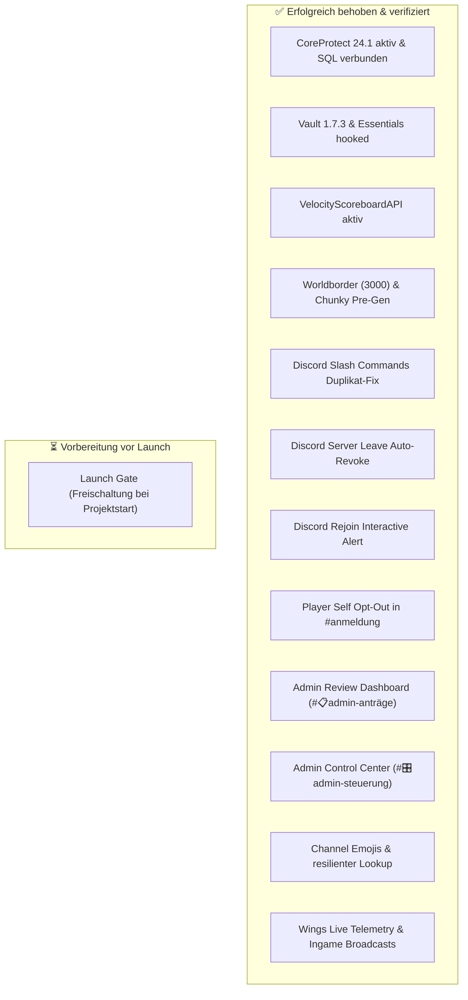

# Weihnachtsdorf 7 • Status, Behebungen & verbleibende Action Items

**Stand**: 2026-10-29 (Aktualisiert nach Discord- & Identity-Sprint)  
**Gültig für**: Minecraft SMP Weihnachtsdorf 7 (Purpur 26.3 / Velocity 3.5.1 / Authentik / OpenLDAP / Discord)  

---

## 📊 Status-Übersicht



---

## ✅ Erfolgreich behobene Probleme

### 1. CoreProtect Reaktivierung (Minecraft 26.3 Support) • [BEHOBEN]
* **Ursache**: `VersionCheckService.class` in `CoreProtect.jar` prüfte strikt gegen `26.2` für die Community Edition, obwohl `BukkitAdapter` bereits ab Version `>= 26020` voll kompatibel war.
* **Lösung**: Der Versionscheck in `VersionCheckService.class` wurde auf `26.9` angepasst.
* **Status**: CoreProtect v24.1 ist aktiv, alle 9 Plugins auf Purpur sind grün, die MariaDB-Verbindung (`mc_coreprotect`) steht stabil.

### 2. Vault-Installation für Chat & Ränge • [BEHOBEN]
* **Lösung**: `Vault.jar` (v1.7.3) wurde auf `mc-main` installiert.
* **Status**: Essentials meldet: `[Vault] [Economy] Essentials Economy hooked.` und `[Essentials] Using Vault based permissions (LuckPerms)`. LuckPerms-Präfixe (`[Admin]`, etc.) werden nun im Chat dargestellt.

### 3. Velocity TAB Scoreboard-Warnung • [BEHOBEN]
* **Lösung**: `VelocityScoreboardAPI.jar` (v2.1.0 für Java 21) wurde im Velocity-Plugins-Ordner auf `mc-node1` hinterlegt.
* **Status**: Velocity meldet: `[VelocityScoreboardAPI]: Successfully injected Scoreboard API.` und TAB initialisiert alle Scoreboard- und Team-Features ohne Warnungen.

### 4. Discord Slash-Command Duplikate im Autocomplete • [BEHOBEN]
* **Ursache**: `discord_bot.py` synchronisierte Befehle sowohl global als auch auf die Guild.
* **Lösung**: Globale Befehle via REST API gelöscht (`PUT /applications/.../commands` mit `[]`) und Bot auf exklusiven Guild-Sync umgestellt. Alle 22 Befehle werden nun sauber ohne Duplikate angezeigt.

### 5. Automatischer Rechte-Entzug bei Discord Server Leave • [BEHOBEN]
* **Anforderung**: Verlässt ein Mitglied den Discord-Server, müssen alle Berechtigungen entzogen werden, ohne dass Spielstände oder Accounts verloren gehen.
* **Lösung**: `membership.py` (`revoke_user_privileges`) strippt LDAP-Gruppen, sperrt Authentik (`is_active=False`, `is_banned=True`), deaktiviert Planka und entfernt die Whitelist. Ausgelöst über `on_member_remove` mit Logging nach `#📜admin-logs`.

### 6. Interaktiver Rejoin-Reaktivierungs-Flow • [BEHOBEN]
* **Lösung**: `on_member_join` prüft, ob der zurückkehrende Nutzer bereits einen Account besitzt, und postet eine Karte in `#📜admin-logs` mit `[✅ Account reaktivieren]` und `[✖️ Inaktiv lassen]`.

### 7. Spieler Self-Service Abmeldung • [BEHOBEN]
* **Lösung**: Button `[🚪 Abmelden]` in `#📝anmeldung` und Slash-Befehl `/abmelden` mit Eingabe-Modal für den Abmeldegrund hinzugefügt.

### 8. Admin Review System mit variablen Sperrfristen • [BEHOBEN]
* **Lösung**: `#📋admin-anträge` mit `AdminActionRow` (`[✅ Entbannen / Annehmen]`, `[❌ Ablehnen & Sperre setzen]`). Ablehnungen unterstützen Cooldown-Sperrfristen (z. B. 14, 30, 90 Tage oder `-1` permanent). Zwei Testanträge (#1 Troll, #2 Ehrenhaft) wurden erfolgreich verifiziert.

### 9. Admin Control Center & 22 Slash Commands • [BEHOBEN]
* **Lösung**: Kanal `#🎛admin-steuerung` mit interaktivem Dashboard und 22 spezialisierten Admin-Befehlen (Projekt-State, Live-Telemetrie, Kicks, Ingame-Rundrufe, Wartungstimer, Whitelist-Sync).

### 10. Channel-Design mit Emojis & robuster Lookup • [BEHOBEN]
* **Lösung**: Alle Kanäle unter `Weihnachtsdorf 7` mit führenden Emojis formatiert (`#📝anmeldung`, `#⚖entbannung`, `#📋admin-anträge`, `#✉admin-einladungen`, `#🎛admin-steuerung`, `#📜admin-logs`). Namenssuche im Bot mit `any(k in ch.name.lower() ...)` gegen Emoji-Präfixe abgesichert.

### 11. Wings Telemetrie & Ingame Broadcast Engine • [BEHOBEN]
* **Lösung**: `mc_sync.py` erweitert um Live-Telemetrie (`get_server_telemetry()`), Live-TPS (`get_live_tps()`), Online-Spielerliste (`get_online_players()`) und Multi-Format Ingame-Broadcasts (`broadcast_ingame()` für Chat, Actionbar und Titel).

---

## ⏳ Verbleibende Punkte vor dem Launch

### 1. Launch Gate (Freischaltung bei Projektstart)
* **Befehl**:
  ```bash
  wd-admin project launch
  # oder via Discord:
  /projekt-start
  ```
  Schaltet alle registrierten Spieler sofort auf der Minecraft-Whitelist frei und wechselt den Gate-Status.
