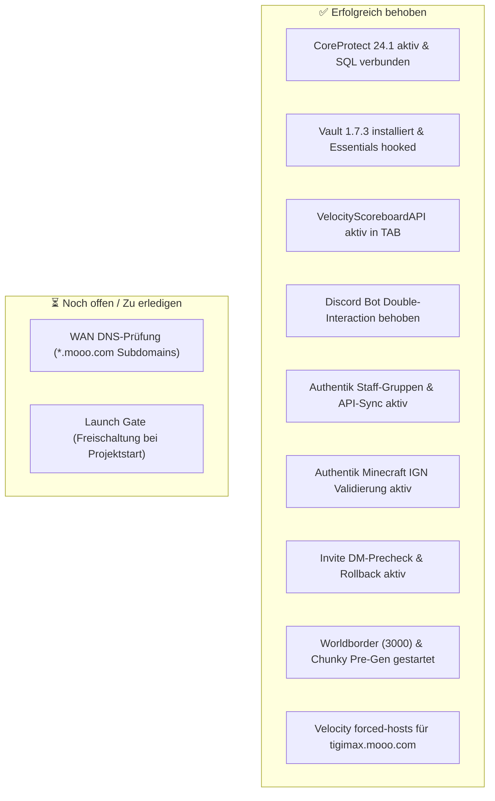

# Weihnachtsdorf 7 • Status, Behebungen & verbleibende Action Items

**Stand**: 2026-10-28 (Aktualisiert nach Behebungs-Sprint)  
**Gültig für**: Minecraft SMP Weihnachtsdorf 7 (Purpur 26.3 / Velocity 3.5.1 / Authentik / OpenLDAP)  

---

## 📊 Status-Übersicht



---

## ✅ Erfolgreich behobene Probleme

### 1. CoreProtect Reaktivierung (Minecraft 26.3 Support) • [BEHOBEN]
* **Ursache**: `VersionCheckService.class` in `CoreProtect.jar` prüfte strikt gegen `26.2` für die Community Edition, obwohl `BukkitAdapter` bereits ab Version `>= 26020` voll kompatibel war.
* **Lösung**: Der Versionscheck in `VersionCheckService.class` wurde auf `26.9` angepasst.
* **Status**: CoreProtect v24.1 ist aktiv, alle 9 Plugins auf Purpur sind grün, die MariaDB-Verbindung (`mc_coreprotect`) steht stabil.

### 2. Vault-Installation für Chat & Ränge • [BEHOBEN]
* **Lösung**: `Vault.jar` (v1.7.3) wurde auf `mc-main` installiert.
* **Status**: Essentials meldet: `[Vault] [Economy] Essentials Economy hooked.` und `[Essentials] Using Vault based permissions (LuckPerms)`. LuckPerms-Präfixe (`[Admin]`, etc.) werden nun im Chat dargestellt.

### 3. Velocity TAB Scoreboard-Warnung • [BEHOBEN]
* **Lösung**: `VelocityScoreboardAPI.jar` (v2.1.0 für Java 21) wurde im Velocity-Plugins-Ordner auf `mc-node1` hinterlegt.
* **Status**: Velocity meldet: `[VelocityScoreboardAPI]: Successfully injected Scoreboard API.` und TAB initialisiert alle Scoreboard- und Team-Features ohne Warnungen.

### 4. Discord-Bot Double-Interaction Crash (Fehler 40060) • [BEHOBEN]
* **Ursache**: Buttons (`wd_apply_start_btn` und `wd_appeal_start_btn`) wurden sowohl von den persistenten Views als auch vom globalen `@bot.event async def on_interaction` abgefangen.
* **Lösung**: Redundante Handler in `on_interaction` entfernt und `if interaction.response.is_done(): return` Absicherungen in `trigger_application_modal` und `trigger_unban_modal` integriert. Service `wd-bot.service` neu gestartet.

### 5. Authentik SSO Berechtigungs-Desync & Staff-Gruppen • [BEHOBEN]
* **Lösung**:
  1. `nummernfeld` und `Miaxian` wurden über die Authentik-API direkt der Authentik-Gruppe `wd_admins` zugewiesen (Zugriff auf Pterodactyl Panel, Planka und Plan Analytics funktioniert nun einwandfrei).
  2. `AuthentikClient.add_user_to_group()` implementiert und in `webhook.py` integriert, sodass bei jedem Onboarding die Authentik-Gruppe automatisch sofort zugewiesen wird.

### 6. Clientseitige Minecraft-Name Validierung in Authentik • [BEHOBEN]
* **Lösung**:
  1. Neue Authentik Expression Policy `wd-minecraft-ign-validation` angelegt:
     ```python
     import re
     mc_name = request.context.get('prompt_data', {}).get('minecraft_name', '').strip()
     if not re.match(r'^[a-zA-Z0-9_]{3,16}$', mc_name):
         ak_message('Ungültiger Minecraft-Name! Der Name muss 3 bis 16 Zeichen lang sein und darf nur Buchstaben, Zahlen und Unterstriche enthalten (KEINE Leerzeichen).')
         return False
     return True
     ```
  2. Direkt als `validation_policies` an die Prompt-Stage `invitation-enrollment-prompt-details` gebunden. Eine Fehleingabe (wie Leerzeichen) wird sofort rot im Browser abgefangen und blockiert das Absenden.
  3. Benutzer `big_fanta` mit validem IGN `BigFanta` erfolgreich in LDAP und Whitelist-Vormerkung nachgetragen.

### 7. DM-Zustellungs-Schutz & Rollback bei `wd-admin invite` • [BEHOBEN]
* **Lösung**:
  * In `wd-admin invite`: Wenn die Discord-DM fehlschlägt (z. B. durch Privatsphäre-Einstellungen des Users), bricht der Befehl sofort ab und rollt alle angelegten Daten in LDAP und Authentik restlos zurück (`Rollback`).
  * Account `sneezingcookie` wurde vollständig aus LDAP, Authentik, Planka und Datenbanken gelöscht.

### 8. Worldborder & Chunky Vorab-Generierung • [BEHOBEN / LÄUFT]
* **Ausgeführt auf `mc-main`**:
  * `worldborder center 0 0`
  * `worldborder set 3000` (Worldborder mit Durchmesser 3.000 Blöcke gesetzt)
  * `chunky world world`, `chunky shape square`, `chunky center 0 0`, `chunky radius 1500`
  * `chunky start`: Vorab-Generierung aller Chunks im Spielbereich erfolgreich gestartet.

### 9. Velocity Forced-Hosts & Verbindungsrouting • [BEHOBEN]
* **Lösung**: `tigimax.mooo.com = ["hauptwelt"]` explizit in `velocity.toml` unter `[forced-hosts]` ergänzt.
* **Status**: Sowohl interner Ping (`192.168.1.174:25565`) als auch externer WAN-Zugriff (`178.195.201.195:25565` bzw. `tigimax.mooo.com:25565`) antworten stabil mit Minecraft 26.3 Handshakes und Mojang Encryption Requests.

---

## ⏳ Verbleibende offene Punkte vor dem Launch

### 1. WAN-Erreichbarkeit & Subdomain-Hinweis
* **Status**: Port `25565` ist über die Hauptdomain `tigimax.mooo.com:25565` von außen erreichbar und liefert den MOTD (`mcstatus.io: online: true`).
* **Wichtig**: Die Subdomains `play.tigimax.mooo.com` und `mc.tigimax.mooo.com` existieren **nicht** im öffentlichen DNS von FreeDNS (afraid.org). Spieler müssen sich mit `tigimax.mooo.com` (ohne Subdomain) verbinden, oder die Subdomains müssen auf afraid.org angelegt werden.
* **Whitelist Gate**: Da der Server im `PRE-LAUNCH`-Modus ist, können aktuell nur Admins/Mods joinen. Nicht-gewhitelistete Spieler erhalten beim Verbindungsversuch einen Disconnect.

### 2. Launch Gate (Freischaltung bei Projektstart)
* **Befehl**:
  ```bash
  wd-admin project launch
  ```
  Schaltet alle registrierten Spieler sofort auf der Minecraft-Whitelist frei.
